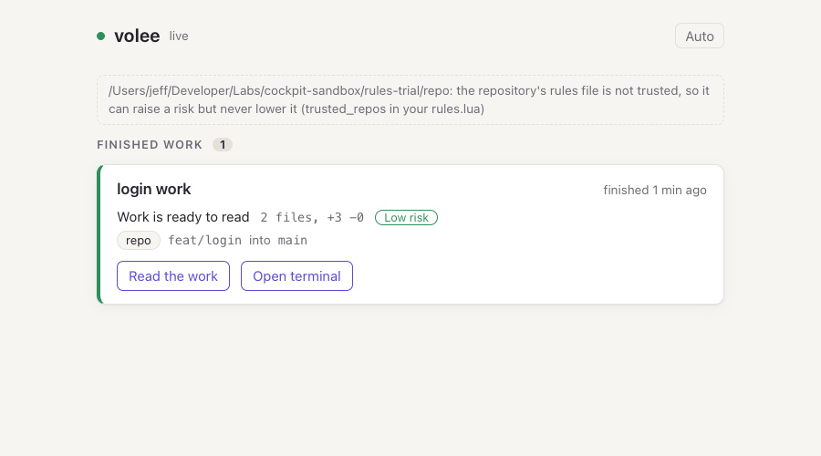

<div align="center">

<h1>
  <picture>
    <source media="(prefers-color-scheme: dark)" srcset="assets/brand/wordmark-dark.svg">
    
  </picture>
</h1>

**A control tower for your Claude Code agents: it tells you what needs a decision, and lets you decide with as little reading as the risk allows.**

[](https://github.com/volee-org/volee/actions/workflows/ci.yml)
[](https://volee-org.github.io/volee/)
[](#license)
[](https://github.com/volee-org/volee/blob/main/Cargo.toml)

</div>

> [!NOTE]
> This is volee v2, a restart on the `v2` branch. It is not released yet: the
> latest release (0.18) is a different tool, a terminal interface that owned
> the agents' terminals. The [roadmap](https://volee-org.github.io/volee/project/roadmap.html)
> says what remains before v2.0.0.

## Why

You run several Claude Code agents at once, across repositories. The scarce
resource is no longer typing, it is attention: every agent produces work to
read, questions to answer and permissions to grant, at moments you do not
choose. The two ways to fail are rubber-stamping (approve everything) and
overload (read everything).

volee watches your agents and puts what needs you in one **decision inbox**, a
page in your browser served by a small local daemon:

- **A permission** an agent asks for: allow once, allow with a rule Claude Code
  suggested, or deny with a reason the model reads.
- **A question** an agent asks: pick one of the proposed answers or write your
  own, without going to the terminal.
- **Finished work**: read it in layers (summary, plan, open points, AI review,
  diagram, guided diff), only as deep as its risk asks, then merge, ask for a
  fix, comment a line or open the file in your own editor.



## How it works

volee **observes** Claude Code. It never starts an agent, holds a terminal or
types into one.

- Claude Code posts its **hooks** over `http` to the daemon on `127.0.0.1`.
  A permission or a question is held until you decide in the browser, then
  answered through the hook's response; if you answer in the terminal first,
  the card goes away.
- The daemon lists sessions with `claude agents --json`, reads git in each
  session's directory and reads the transcript for the plan and the reasons.
  Git is the truth, the transcript is commentary, and when a transcript cannot
  be read the screen says so and shows what git and the hooks know.
- Your **rules** are Lua: `config.lua` for the machine and `rules.lua` (one per
  repository, one personal) for risk, the layers shown, the review plan and
  automatic merge. A broken file falls back to the safest rule: full read, no
  automatic merge.
- The **AI review** is Claude Code's own `/code-review`, shown as an opinion on
  the card, never as a gate.
- Merging is done by the daemon with delivery evidence and a journal line;
  automatic merge exists for low risk changes, in the repositories you list.
- An optional adapter (Rex) focuses an agent's terminal from the page.

Read the [architecture overview](https://volee-org.github.io/volee/architecture/overview.html)
and the [design decisions](https://volee-org.github.io/volee/adr/README.html).

## Install

v2 has no release yet. See the
[installation guide](https://volee-org.github.io/volee/guide/installation.html)
for what is available, or build it from source (Rust 1.90 or later, and
Node 24 for the web interface):

```sh
git clone --branch v2 https://github.com/volee-org/volee
cd volee
(cd ui && npm ci && npm run build)   # the interface the binary embeds
cargo build --release -p volee-cli   # target/release/volee
```

volee supports macOS and Linux and needs [Claude Code](https://code.claude.com)
2.1.330 (the version v2 was measured on; it needs hooks over `http` and
`claude agents --json`).

Then, in the [getting started guide](https://volee-org.github.io/volee/guide/getting-started.html):
start the daemon, run `volee doctor` in a project, run `volee ui`.

## Contributing

Contributions are welcome, including ones written with coding agents. Start
with [CONTRIBUTING.md](CONTRIBUTING.md); agents read [AGENTS.md](AGENTS.md).
By participating you agree to the [Code of Conduct](CODE_OF_CONDUCT.md).

## License

Licensed under either of [Apache License, Version 2.0](LICENSE-APACHE) or
[MIT license](LICENSE-MIT) at your option.

Unless you explicitly state otherwise, any contribution intentionally submitted
for inclusion in the work by you, as defined in the Apache-2.0 license, shall
be dual licensed as above, without any additional terms or conditions.
