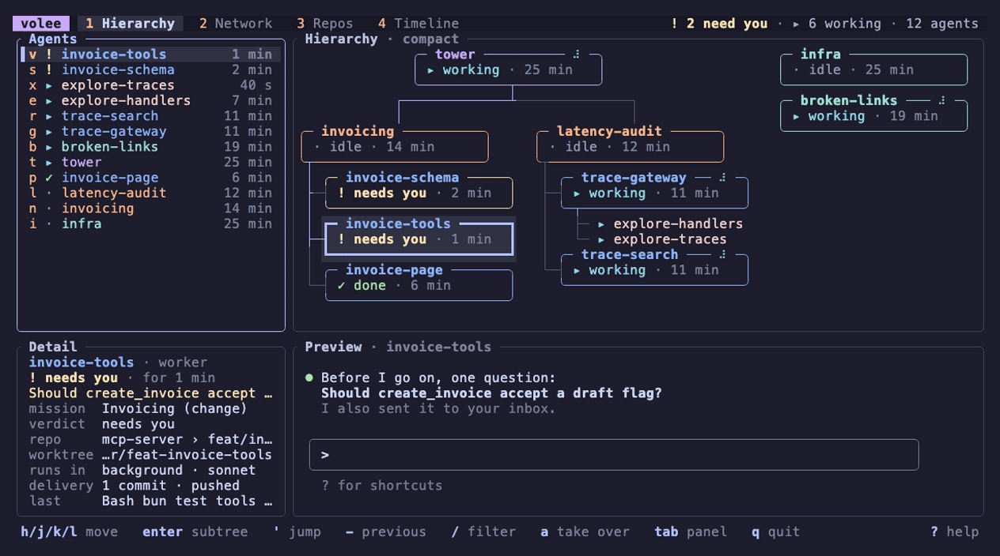

<div align="center">

<h1>
  <picture>
    <source media="(prefers-color-scheme: dark)" srcset="assets/brand/wordmark-dark.svg">
    
  </picture>
</h1>

**See, launch and coordinate every coding agent on your machine, from your terminal.**

[](https://github.com/volee-org/volee/actions/workflows/ci.yml)
[](https://volee-org.github.io/volee/)
[](#license)
[](https://github.com/volee-org/volee/blob/main/Cargo.toml)

</div>

> [!NOTE]
> volee is young and built in the open. Expect rough edges and tell us about
> them; the [roadmap](https://volee-org.github.io/volee/project/roadmap.html)
> says what comes next.

## Why

You run five Claude Code sessions in five worktrees. One waits for a
permission, one finished an hour ago, two are talking to each other through a
coordinator, and you are not sure which branch was pushed. volee answers, in
one screen:

- **Who is running?** Every agent on the machine, with its state, repository,
  branch and worktree, whether you started it or another agent did.
- **Who needs me?** Permission prompts, questions and finished work, sorted by
  urgency.
- **What did they do?** Commits, diffs, push state, pull request and checks.
- **Who talks to whom?** Messages between agents and with you, as threads and
  as a live graph where each message travels along its edge.

It also runs **missions**: a goal across one or more repositories, split by a
coordinator agent and delivered by worker agents, with delivery checked by
code, not by trust.

## How it works

- Each agent volee launches runs in a volee host, a small process that holds
  its terminal and its exact screen, so it survives closed windows, the
  interface and the daemon. Take one over with `a` or `volee attach`, come
  back with `Ctrl+Q`.
- Previews, a full-screen view and a wall of live screens show each agent
  volee hosts exactly as its terminal does, status line included, without
  resizing it.
- volee launches Claude Code and OpenCode agents. Agents started elsewhere
  are shown read only, and a key adopts one into a host.
- After a reboot, the daemon resumes the agents the reboot interrupted, with
  their conversation. `volee daemon install` starts it at login, if you want.
- Sessions you started by hand in a tuios or tmux pane are found in that
  pane: their preview is the pane's screen, and `a` brings the pane forward.
- Each new worktree can run your setup commands, such as `bun install`,
  before its agent starts.
- A small local daemon keeps the registry, the event log and the messages in
  SQLite. The interface, the command line and the agents all talk to it.
- Agents message each other through an MCP server, which any MCP-capable
  harness can use.
- No multiplexer, editor or git client is required: the ones you use (Neovim,
  lazygit, VS Code...) open an agent's worktree with a key.

Read the [architecture overview](https://volee-org.github.io/volee/architecture/overview.html)
and the [design decisions](https://volee-org.github.io/volee/adr/README.html).

## Install

The latest release is v0.7.0. Each [release](https://github.com/volee-org/volee/releases)
has prebuilt binaries for macOS (Apple Silicon and Intel) and Linux (x86_64
and ARM64), and an installer that checks the download and puts `volee` in
`~/.local/bin`:

```sh
curl --proto '=https' --tlsv1.2 -LsSf https://github.com/volee-org/volee/releases/latest/download/volee-cli-installer.sh | sh
```

Or build it from source with Cargo (Rust 1.89 or later):

```sh
cargo install --locked --git https://github.com/volee-org/volee --tag v0.7.0 volee-cli
```

volee supports macOS and Linux and needs [Claude Code](https://code.claude.com)
2.1.319 or later for its agent features. The
[installation guide](https://volee-org.github.io/volee/guide/installation.html)
covers specific versions, manual downloads and uninstalling.

Open the interface on every agent of your machine, or try it on a simulated
team of agents first, no setup needed:

```sh
volee        # the agents on this machine; starts the daemon when needed
volee demo   # a simulated team
```



Then launch your first agent with the
[getting started guide](https://volee-org.github.io/volee/guide/getting-started.html):
it takes about ten minutes.

## Contributing

Contributions are welcome, including ones written with coding agents. Start
with [CONTRIBUTING.md](CONTRIBUTING.md); agents read [AGENTS.md](AGENTS.md).
By participating you agree to the [Code of Conduct](CODE_OF_CONDUCT.md).

## License

Licensed under either of [Apache License, Version 2.0](LICENSE-APACHE) or
[MIT license](LICENSE-MIT) at your option.

Unless you explicitly state otherwise, any contribution intentionally submitted
for inclusion in the work by you, as defined in the Apache-2.0 license, shall
be dual licensed as above, without any additional terms or conditions.
