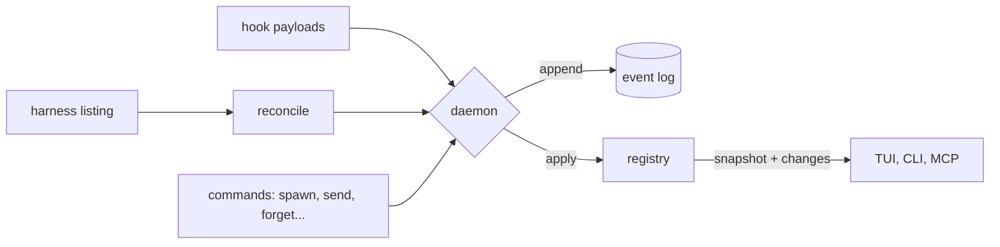

# Domain model

The domain lives in the `volee-core` crate. It performs no IO and never reads
the clock, so every rule below is unit-tested.

## Event sourcing in one page

volee's state is a **registry** built by applying **events** in order. The
daemon validates an event, appends it to the log, applies it to the in-memory
registry and notifies subscribers, in that order. Restarting the daemon
replays the log.

## Entities

| Entity | Identity | Notes |
| --- | --- | --- |
| Agent | `ag_<ulid>` | Role, parent, mission, workspace, location, state, delivery evidence. Owns a lineage of sessions. |
| Session | harness + harness id | For Claude Code, the session UUID. The last linked session is the current one. |
| Mission | `ms_<ulid>` | Goal, kind (change or analysis), repositories, coordinator, status, report. |
| Thread | `th_<ulid>` | A mission thread, a direct thread between two parties, or the inbox. |
| Message | `msg_<ulid>` | Sender, kind, body, references, reply-to, one receipt per recipient. |

Identifiers are ULIDs, so they sort by creation time.

## Agent states

| State | Meaning | Live |
| --- | --- | --- |
| `launching` | Launched by volee, not seen running yet | yes |
| `working` | Running a turn | yes |
| `needs-input` | Waits for a person: permission, question or dialog | yes |
| `idle` | Alive, waiting for its next instruction | yes |
| `done` | Finished its last task | yes |
| `failed` | Ended with an error | no |
| `stopped` | Process stopped; the conversation can be resumed | no |
| `lost` | volee cannot find it any more; never treated as done | no |

Lists sort by urgency: `needs-input`, `failed`, `working`, `launching`,
`done`, `idle`, `stopped`, `lost`, and the most recent change first within a
group.

## Events

| Event | Effect |
| --- | --- |
| `agent-registered` | A new agent, in state `launching`. |
| `session-linked` | A session joins an agent and becomes current (started, resumed, forked or discovered). A session never belongs to two agents. |
| `state-changed` | New state and detail. `state_since` moves only when the state really changes. |
| `activity-recorded` | The last thing the agent did, in one line. |
| `workspace-updated`, `location-changed`, `model-changed` | Better knowledge of where and how the agent runs. |
| `delivery-updated` | New delivery evidence from git or the forge. |
| `agent-forgotten` | The agent is removed; its sessions are ignored from then on. |
| `stop-requested` | The human stopped the agent: it is held, and volee does not resume it on its own. A later `message-posted` from the human to it lifts the hold. |
| `thread-opened`, `message-posted`, `message-delivered`, `message-read` | Conversations and receipts. |
| `mission-created`, `mission-updated` | Missions and their progress. When a mission ends, every agent of it is held for good. |
| `worker-assessed` | The supervisor's verdict on a worker of a mission, with its evidence. |

## Reconciliation

`reconcile` compares a harness listing with the registry and returns events:

- a listed session of a known agent updates its state only when the coarse
  category differs, so a richer state from hooks (for example "permission for
  `Bash`") is never overwritten by a coarser one;
- a live session nobody owns becomes an `independent` agent; finished sessions
  nobody owns are history and are skipped;
- when a complete listing no longer contains an agent's current session, the
  agent becomes `stopped` (it ran in a terminal) or `lost` (it ran in the
  background). It never becomes `done` because it disappeared.

The daemon runs it (module `discovery` of `volee-daemon`) against `claude
agents --json --all`, which costs about 0.17 s of CPU and starts a Node
process each time, so the cadence follows who watches and what changes:

- when the daemon starts, it lists at once;
- while an interactive client (the interface) is subscribed, it waits two
  seconds after a listing that changed something (a session linked to its
  agent, or reconciled events), and twice as long after each listing that
  changed nothing, up to ten seconds (`discovery_interval` and
  `max_discovery_interval` of its configuration);
- with no interactive client, it waits thirty seconds
  (`idle_discovery_interval`);
- a new interactive subscription lists at once, so the interface opens on
  fresh data, and so does a `discovery.refresh` request, which answers once
  a listing that started after it is applied (`volee ls` sends one; requests
  made meanwhile share the listing). Both bring the two-second wait back.

Hook events never shorten the wait: agents volee launched report through
their hooks in real time whatever discovery does, and resetting on them
would keep the shortest wait exactly while agents work. Only sessions
started elsewhere, and sessions that end without a word, show up later
while nothing changes or nobody watches. Each wait starts when the previous
listing ends, so a slow listing on a loaded machine never runs back to back.
The listing runs outside the state lock, so a slow `claude` never blocks
requests; a failing listing changes nothing (so the wait keeps growing) and
is logged once, then again when it works. When Claude Code is missing or too
old, `volee daemon status` says why and discovery stays off.

## The mission supervisor

`supervisor::supervise` is the program half of a mission (ADR 0007). The
daemon calls it after events that concern a mission and applies its
decision: events to commit and notices to send from volee in the mission
thread. It is idempotent: once its own events are applied, calling it again
returns nothing.

| Worker state | Verdict |
| --- | --- |
| launching, working | none yet |
| needs input | `needs-human` |
| failed | `failed` (the human is told too) |
| lost | `lost` (the human is told too) |
| idle, done, stopped | `delivered` or `not-delivered`, from the evidence below |

Delivery evidence depends on the mission kind:

- **change**: commits, all pushed, an open or merged pull request, and a clean
  tree; a merged branch or pull request always counts;
- **analysis**: a `report` message from the worker.

A pull request counts only when its head commit is the branch's tip
(`Delivery::pull_request_at_tip`): an old pull request of a reused branch
name, or one read before the branch moved on, proves nothing about the work
as it is.

A change worker is judged only on fresh evidence: evidence checked before it
stopped (`checked_at` earlier than its `state_since`) may miss its last
commits, push or pull request, so the verdict waits for the daemon's next
check, which the stop itself triggers. The coordinator therefore never hears
"not delivered" just before "delivered". Evidence that was never checked (a
daemon without a git source) is judged as it is.

Every new or changed verdict is recorded as `worker-assessed` and told to the
coordinator. When every worker delivered, the mission moves to `reporting`
and the coordinator and the human are asked for the final report, once. A
delivered worker that works again (to answer its coordinator, say) keeps its
delivery until a new verdict says otherwise; a new verdict that is not
`delivered` moves the mission back to `running`.

In the daemon (`volee-daemon`, module `missions`), supervision follows every
commit: the daemon finds the missions the new events concern (an agent of
the mission changed state or delivery, posted a message, or registered),
first records a newly registered coordinator on its mission, then runs
`supervise` and commits the decision in one batch. The supervisor's own
events never trigger another round. It also runs over every open mission
when the daemon starts, which catches up after a crash between a commit and
its follow-ups, or after an upgrade that changed the rules. A failure there
is logged and never fails the request that caused it: the events that
triggered it are already committed.

## Rules

- **Routing** (`Registry::check_route`): people and volee write to anyone;
  agents write to people; between agents, members of the same mission write to
  each other, and otherwise an agent writes to its parent, its children, its
  mission's coordinator and the agent that requested its mission.
- **Cleanup** (`delivery::tidy_verdict`): a worktree may be removed only when
  the agent is not busy, the tree is clean, and the work is delivered (merged,
  merged through a pull request, or reported). Every missing condition is
  reported at once. `delivery::tidy_check` adds what makes a worktree volee's
  to remove: the agent was launched by volee, the worktree lies under
  `<repository>/.claude/worktrees/`, and the delivery evidence was checked
  since the agent's last change (stale or missing evidence proves nothing).
  The branch is never part of the decision: it is always kept.
- **Delivery evidence** (`delivery::Delivery`) describes the agent's branch:
  `commits` counts its commits that the base branch does not have, and `tip`
  is the commit it was computed from. A merge leaves no commit of the branch
  outside the base branch, which looks exactly like a branch that never had
  any, so the evidence carries a memory: `unmerged_tip`, the last tip seen
  with commits of its own. `merged_into_base` is true only once that commit
  is part of the base branch. The daemon passes the previous `unmerged_tip`
  back to git on each check; `delivery-updated` events keep it across
  restarts. `checked_at` is when the daemon began the check that produced the
  evidence, which tells the supervisor whether it is fresh (above). The pull
  request carries its `head` commit, so the supervisor and cleanup count it
  only at that tip. How git computes each fact, how a pull request is matched
  to the branch, and when the daemon checks, is described in [Git](git.md).
