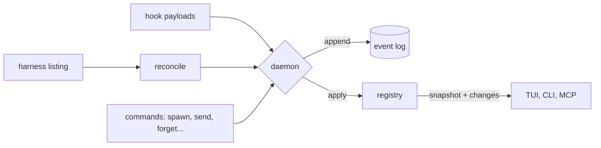

# Domain model

The domain lives in the `volee-core` crate. It performs no IO and never reads
the clock, so every rule below is unit-tested.

## Event sourcing in one page

volee's state is a **registry** built by applying **events** in order. The
daemon validates an event, appends it to the log, applies it to the in-memory
registry and notifies subscribers, in that order. Restarting the daemon
replays the log.

## Entities

| Entity | Identity | Notes |
| --- | --- | --- |
| Agent | `ag_<ulid>` | Role, parent, mission, workspace, location, state, delivery evidence. Owns a lineage of sessions. |
| Session | harness + harness id | For Claude Code, the session UUID. The last linked session is the current one. |
| Mission | `ms_<ulid>` | Goal, kind (change or analysis), repositories, coordinator, status, report. |
| Thread | `th_<ulid>` | A mission thread, a direct thread between two parties, or the inbox. |
| Message | `msg_<ulid>` | Sender, kind, body, references, reply-to, one receipt per recipient. |

Identifiers are ULIDs, so they sort by creation time.

## Agent states

| State | Meaning | Live |
| --- | --- | --- |
| `launching` | Launched by volee, not seen running yet | yes |
| `working` | Running a turn | yes |
| `needs-input` | Waits for a person: permission, question or dialog | yes |
| `idle` | Alive, waiting for its next instruction | yes |
| `done` | Finished its last task | yes |
| `failed` | Ended with an error | no |
| `stopped` | Process stopped; the conversation can be resumed | no |
| `lost` | volee cannot find it any more; never treated as done | no |

Lists sort by urgency: `needs-input`, `failed`, `working`, `launching`,
`done`, `idle`, `stopped`, `lost`, and the most recent change first within a
group.

## Events

| Event | Effect |
| --- | --- |
| `agent-registered` | A new agent, in state `launching`. |
| `session-linked` | A session joins an agent and becomes current (started, resumed, forked or discovered). A session never belongs to two agents. |
| `state-changed` | New state and detail. `state_since` moves only when the state really changes. |
| `activity-recorded` | The last thing the agent did, in one line. |
| `workspace-updated`, `location-changed`, `model-changed` | Better knowledge of where and how the agent runs. |
| `delivery-updated` | New delivery evidence from git or the forge. |
| `agent-forgotten` | The agent is removed; its sessions are ignored from then on. |
| `thread-opened`, `message-posted`, `message-delivered`, `message-read` | Conversations and receipts. |
| `mission-created`, `mission-updated` | Missions and their progress. |
| `worker-assessed` | The supervisor's verdict on a worker of a mission, with its evidence. |

## Reconciliation

`reconcile` compares a harness listing with the registry and returns events:

- a listed session of a known agent updates its state only when the coarse
  category differs, so a richer state from hooks (for example "permission for
  `Bash`") is never overwritten by a coarser one;
- a live session nobody owns becomes an `independent` agent; finished sessions
  nobody owns are history and are skipped;
- when a complete listing no longer contains an agent's current session, the
  agent becomes `stopped` (it ran in a terminal) or `lost` (it ran in the
  background). It never becomes `done` because it disappeared.

## The mission supervisor

`supervisor::supervise` is the program half of a mission (ADR 0007). The
daemon calls it after events that concern a mission and applies its
decision: events to commit and notices to send from volee in the mission
thread. It is idempotent: once its own events are applied, calling it again
returns nothing.

| Worker state | Verdict |
| --- | --- |
| launching, working | none yet |
| needs input | `needs-human` |
| failed | `failed` (the human is told too) |
| lost | `lost` (the human is told too) |
| idle, done, stopped | `delivered` or `not-delivered`, from the evidence below |

Delivery evidence depends on the mission kind:

- **change**: commits, all pushed, an open or merged pull request, and a clean
  tree; a merged branch or pull request always counts;
- **analysis**: a `report` message from the worker.

Every new or changed verdict is recorded as `worker-assessed` and told to the
coordinator. When every worker delivered, the mission moves to `reporting`
and the coordinator and the human are asked for the final report. A worker
that regresses moves the mission back to `running`.

## Rules

- **Routing** (`Registry::check_route`): people and volee write to anyone;
  agents write to people; between agents, members of the same mission write to
  each other, and otherwise an agent writes to its parent, its children and its
  mission's coordinator.
- **Cleanup** (`delivery::tidy_verdict`): a worktree may be removed only when
  the agent is not busy, the tree is clean, and the work is delivered (merged,
  merged through a pull request, or reported). Every missing condition is
  reported at once.
