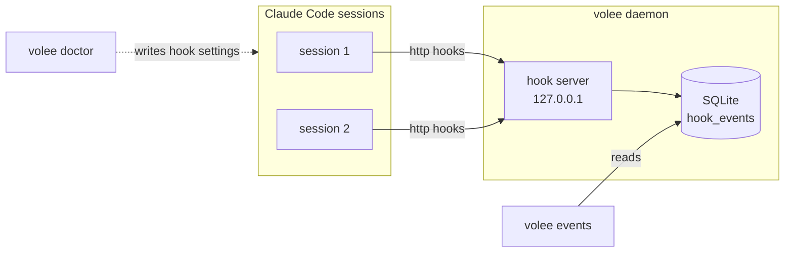

# Architecture overview

This page describes volee v2 as it is built, stage by stage. The plan and the
reasons for the restart are in `docs/v2/framing.md` in the repository; each
significant choice has an architecture decision record (ADR) in
[Decisions](../adr/README.md). Decisions of 0.x that the restart superseded
stay in the list, marked as such.

> [!NOTE]
> v2 is under construction on the `v2` branch. This page covers what exists:
> **stage 1, the hook server**. Parts of the 0.x daemon (the registry, the
> messages, the missions, the merge flow) are still in the code and are
> adapted in later stages; the pages of the user guide and the other
> architecture pages still describe 0.x.

## What volee v2 is for

A person runs several Claude Code agents at once, across repositories. The
scarce resource is no longer typing but attention: every agent produces work
to read, questions to answer and permissions to grant, at unpredictable
moments. volee is a control tower against that fatigue. It **observes**
Claude Code, tells the person what needs a decision, and lets them decide with
as little reading as the risk allows.

The first version of the product is a decision inbox with three kinds of
cards: finished work, a question, a permission.

## Principles

- **Observe, never own.** volee does not start agents, hold their terminals
  or type into them. Claude Code tells volee what happens, through its own
  hooks. Where a decision has to go back to a session, it goes through a hook
  response, never through a terminal.
- **Never get in the way.** A session must not depend on volee being up. Every
  hook has a short timeout, and an unreachable daemon is a non-blocking error
  for Claude Code (see [When the daemon is down](#when-the-daemon-is-down)).
- **Keep what was said, raw.** Each event is stored exactly as it arrived;
  what it means is decided later, from the raw text, so that a better reading
  never needs the event again.
- **Local and authenticated.** The daemon listens on the loopback interface
  only, and every request carries a per-install token.
- **Evidence before action.** Destructive actions (removing a worktree,
  merging) need delivery evidence. See
  [ADR 0011](../adr/0011-safety-and-delivery-evidence.md).

## Components



| Part | Where | Does |
| --- | --- | --- |
| Hook server | `volee-daemon`, `hook_server.rs` | Receives `POST /hooks/<event>`, checks the token, stores the event, answers with an empty `200`. Decides nothing. |
| Store | `volee-store` | Keeps each hook event in the `hook_events` table: arrival time, event name, session id, working directory and the raw payload. Append-only. |
| `volee doctor` | `volee-cli` | Writes the hook settings that make Claude Code post to the daemon, and says whether the daemon answers. |
| `volee events` | `volee-cli` | Lists the stored events, oldest first, optionally for one session. Reads the database directly, so it works with the daemon stopped. |

## The hook server

The daemon starts the hook server with the rest of itself. It listens on
`127.0.0.1` at the port set under `[hooks]` in the configuration (47835 by
default) and refuses to bind any other interface.

| Request | Answer |
| --- | --- |
| `POST /hooks/<event>` with the right token and a JSON object body | The event is stored; `200` with an empty body. Claude Code reads that as "no opinion" and goes on as if the hook did not exist. |
| The same without the right token | `401`; nothing is stored. |
| A body that is not a JSON object, or an event name that is not a plain word | `400`; nothing is stored. |
| `GET /healthz` | `200 ok`, with no token: what `volee doctor` uses to check the daemon. |

The event name comes from the payload's `hook_event_name`, the path being the
fallback. The session id and the working directory come from the payload's
`session_id` and `cwd`. The body is limited to 8 MiB.

The token is 32 random bytes in hex, created by the first command that needs
it in `hook-token` in the state directory, readable by its owner only. The
daemon compares it in constant time.

## The hook settings

`volee doctor` merges these entries into **one** settings file:

- the project's `.claude/settings.local.json` (the current directory, or
  `--project DIR`), which Claude Code keeps out of version control; or
- `~/.claude/settings.json`, only with `--user`.

It never touches any other file. Everything else in the file is kept, and so
is every hook that is not volee's; a rerun replaces volee's entries instead of
adding more, and `--remove` takes them out. A file that is not valid JSON is
never overwritten. It prints what it wrote.

Sixteen events are subscribed: `SessionStart`, `SessionEnd`,
`UserPromptSubmit`, `PreToolUse`, `PostToolUse`, `PostToolUseFailure`,
`PermissionRequest`, `PermissionDenied`, `Notification`, `Stop`,
`StopFailure`, `SubagentStart`, `SubagentStop`, `TaskCreated`,
`TaskCompleted` and `PreCompact`. Each entry is an `http` hook:

```json
{
  "type": "http",
  "url": "http://127.0.0.1:47835/hooks/PreToolUse",
  "headers": { "Authorization": "Bearer <token>" },
  "timeout": 5
}
```

Two facts about Claude Code's hooks shape this:

- **The token is written in the file.** Claude Code only interpolates
  environment variables that the hook lists in `allowedEnvVars`, and the
  variable would have to exist in every environment that starts Claude Code.
  The file is created readable by its owner only.
- **`SessionStart` takes no `http` hook** (Claude Code accepts only `command`
  and `mcp_tool` hooks there). For that one event `volee doctor` writes a
  `command` hook that runs a silent `curl` to the same URL, ends in `|| true`
  and prints nothing, since the output of a `SessionStart` hook goes to the
  model.

### When the daemon is down

Claude Code treats a refused connection, a timeout and any non-`2xx` answer
from an `http` hook alike: a non-blocking error, and the action goes ahead.
volee does not set `onFailure: "block"`. Measured on Claude Code 2.1.330 with
the daemon stopped: the session ran its tool, answered and exited with status
0 in about the same time as with the daemon up (8 s against 7 s), and `-p` mode printed one line for
the `SessionEnd` hook (`connect ECONNREFUSED 127.0.0.1:<port>`). The events
of that session are not recorded: nothing replays them later.

## What is still 0.x

The registry, event log (`events` table), messages, missions and merge flow of
0.x still run in the daemon and are reached over its Unix socket. They are
reworked in the following stages, as the inbox needs them; until then they are
not part of what this page describes.
