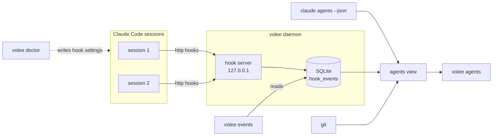

# Architecture overview

This page describes volee v2 as it is built, stage by stage. The plan and the
reasons for the restart are in `docs/v2/framing.md` in the repository; each
significant choice has an architecture decision record (ADR) in
[Decisions](../adr/README.md). Decisions of 0.x that the restart superseded
stay in the list, marked as such.

> [!NOTE]
> v2 is under construction on the `v2` branch. This page covers what exists:
> **stage 1, the hook server**, **stage 2, agents and finished work**, and
> **stage 3, the web interface**. Parts of the 0.x daemon (the registry, the
> messages, the missions, the merge flow) are still in the code and are
> adapted in later stages; the pages of the user guide and the other
> architecture pages still describe 0.x.

## What volee v2 is for

A person runs several Claude Code agents at once, across repositories. The
scarce resource is no longer typing but attention: every agent produces work
to read, questions to answer and permissions to grant, at unpredictable
moments. volee is a control tower against that fatigue. It **observes**
Claude Code, tells the person what needs a decision, and lets them decide with
as little reading as the risk allows.

The first version of the product is a decision inbox with three kinds of
cards: finished work, a question, a permission.

## Principles

- **Observe, never own.** volee does not start agents, hold their terminals
  or type into them. Claude Code tells volee what happens, through its own
  hooks. Where a decision has to go back to a session, it goes through a hook
  response, never through a terminal.
- **Never get in the way.** A session must not depend on volee being up. Every
  hook has a short timeout, and an unreachable daemon is a non-blocking error
  for Claude Code (see [When the daemon is down](#when-the-daemon-is-down)).
- **Keep what was said, raw.** Each event is stored exactly as it arrived;
  what it means is decided later, from the raw text, so that a better reading
  never needs the event again.
- **Local and authenticated.** The daemon listens on the loopback interface
  only, and every request carries a per-install token.
- **Evidence before action.** Destructive actions (removing a worktree,
  merging) need delivery evidence. See
  [ADR 0011](../adr/0011-safety-and-delivery-evidence.md).

## Components



| Part | Where | Does |
| --- | --- | --- |
| Hook server | `volee-daemon`, `hook_server.rs` | Receives `POST /hooks/<event>`, checks the token, stores the event, answers with an empty `200`. Decides nothing. |
| Store | `volee-store` | Keeps each hook event in the `hook_events` table: arrival time, event name, session id, working directory and the raw payload. Append-only. |
| `volee doctor` | `volee-cli` | Writes the hook settings that make Claude Code post to the daemon, and says whether the daemon answers. |
| Agents view | `volee-daemon`, `agents_view.rs` | Polls `claude agents --json`, joins each session to its hook events and to what git says of its worktree, and decides which agents have finished work. Serves `agents.view`. |
| `volee agents` | `volee-cli` | Shows the agents view: state, repository, branch, how far the branch is from its base, finished work with its diff summary. |
| Web interface | `volee-daemon`, `web/` and `ui/` | The inbox in a browser tab: the bundle (embedded), a JSON API and a live event stream, on the hook server's port. See [the web interface](#the-web-interface). |
| `volee ui` | `volee-cli` | Prints and opens the link to the interface, with its token. |
| `volee events` | `volee-cli` | Lists the stored events, oldest first, optionally for one session. Reads the database directly, so it works with the daemon stopped. |

## The hook server

The daemon starts the hook server with the rest of itself. It listens on
`127.0.0.1` at the port set under `[hooks]` in the configuration (47835 by
default) and refuses to bind any other interface.

| Request | Answer |
| --- | --- |
| `POST /hooks/<event>` with the right token and a JSON object body | The event is stored; `200` with an empty body. Claude Code reads that as "no opinion" and goes on as if the hook did not exist (except for a `PermissionRequest`, which is held: see below). |
| The same without the right token | `401`; nothing is stored. |
| A body that is not a JSON object, or an event name that is not a plain word | `400`; nothing is stored. |
| `GET /healthz` | `200 ok`, with no token: what `volee doctor` uses to check the daemon. |

The event name comes from the payload's `hook_event_name`, the path being the
fallback. The session id and the working directory come from the payload's
`session_id` and `cwd`. The body is limited to 8 MiB.

The token is 32 random bytes in hex, created by the first command that needs
it in `hook-token` in the state directory, readable by its owner only. The
daemon compares it in constant time.

## The hook settings

`volee doctor` merges these entries into **one** settings file:

- the project's `.claude/settings.local.json` (the current directory, or
  `--project DIR`), which Claude Code keeps out of version control; or
- `~/.claude/settings.json`, only with `--user`.

It never touches any other file. Everything else in the file is kept, and so
is every hook that is not volee's; a rerun replaces volee's entries instead of
adding more, and `--remove` takes them out. A file that is not valid JSON is
never overwritten. It prints what it wrote.

Sixteen events are subscribed: `SessionStart`, `SessionEnd`,
`UserPromptSubmit`, `PreToolUse`, `PostToolUse`, `PostToolUseFailure`,
`PermissionRequest`, `PermissionDenied`, `Notification`, `Stop`,
`StopFailure`, `SubagentStart`, `SubagentStop`, `TaskCreated`,
`TaskCompleted` and `PreCompact`. Each entry is an `http` hook:

```json
{
  "type": "http",
  "url": "http://127.0.0.1:47835/hooks/PreToolUse",
  "headers": { "Authorization": "Bearer <token>" },
  "timeout": 5
}
```

Two facts about Claude Code's hooks shape this:

- **The token is written in the file.** Claude Code only interpolates
  environment variables that the hook lists in `allowedEnvVars`, and the
  variable would have to exist in every environment that starts Claude Code.
  The file is created readable by its owner only.
- **`SessionStart` takes no `http` hook** (Claude Code accepts only `command`
  and `mcp_tool` hooks there). For that one event `volee doctor` writes a
  `command` hook that runs a silent `curl` to the same URL, ends in `|| true`
  and prints nothing, since the output of a `SessionStart` hook goes to the
  model.

### When the daemon is down

Claude Code treats a refused connection, a timeout and any non-`2xx` answer
from an `http` hook alike: a non-blocking error, and the action goes ahead.
volee does not set `onFailure: "block"`. Measured on Claude Code 2.1.330 with
the daemon stopped: the session ran its tool, answered and exited with status
0 in about the same time as with the daemon up (8 s against 7 s), and `-p` mode printed one line for
the `SessionEnd` hook (`connect ECONNREFUSED 127.0.0.1:<port>`). The events
of that session are not recorded: nothing replays them later.

## Agents and finished work

The daemon lists Claude Code's sessions with `claude agents --json` every
`[agents] poll_interval` seconds (5 by default) and keeps the last reading in
memory; a request that finds it older than a second reads again first. For
each session it builds a card from three sources:

| Source | Gives | Joined by |
| --- | --- | --- |
| `claude agents --json` | Name, state (`busy`, `idle`, `blocked`...), what it waits for, process id, working directory | |
| Hook events in SQLite | The newest event, when the agent last acted, when it last stopped | `session_id` |
| git, on the session's directory | Repository, linked worktree, branch, base branch, commits ahead and behind, uncommitted changes, merged or not, diff summary (files, lines added and removed) | working directory |

Hook payloads carry the session id but no process id, so the join is by
session id alone.

**What an agent costs.** A session whose directory has no `.git` above it is
never given a git command. For one that has, the daemon runs a single cheap
`git status` per reading (the *fingerprint*: branch, commit, whether anything
is uncommitted) and compares it, with the modification time of the worktree's
index, and to the modification times of the base branch's refs (a merge into
the base, or a fetch, does not touch the agent's worktree). If everything is
equal and the facts are less than a minute old, the facts read last time are
reused; otherwise they are read again in full (repository, base branch, ahead
and behind, diff summary). An idle agent therefore costs one `git status`
every few seconds, and a full reading only when it commits, stages, switches
branch or changes a file, when its base moves, or once a minute.

Every source can fail without harm. A listing that fails or changes shape
keeps the previous cards and says why (`volee agents` prints a warning, the
daemon logs it once); an element of the listing that cannot be read is
skipped; a directory git cannot read gives a card without git facts; a
database that cannot be opened gives empty hook facts.

Which sessions Claude Code lists was measured on 2.1.330: interactive
sessions (in a terminal) and background sessions appear; a `claude -p`
session does not, even while it runs.

### Finished work

One function, `is_finished_work` in `volee-core`, takes the facts and answers.
An agent has finished work when:

1. its newest sign of life is a stop (`Stop`, or a `Notification` of type
   `agent_completed` or `idle_prompt`) that came after its last activity
   (`UserPromptSubmit`, `PreToolUse`, `PostToolUse`, `PostToolUseFailure`,
   `PermissionRequest`, `PermissionDenied`);
2. Claude Code does not report it as working, launching or waiting for input;
3. its branch has commits the base branch does not have, whose change is not
   already there as a patch (so a cherry-picked commit is not work to
   review), and the branch is not merged.

Subagent and task events count as neither activity nor stop: on 2.1.330 the
subagent that writes the suggested next prompt stops a few seconds after the
turn's `Stop`, and counting it made a finished agent look busy.

The base branch is the one the agent's branch was created from, when that
can be known, taken from the first of these that names an existing branch: the
branch it tracks (`branch.<name>.merge`), the branch its reflog says it was
"Created from", the nearest local branch (fewest commits the branch has and
the candidate lacks, then the reverse, the default branch winning a tie).
Otherwise it is the repository's default branch (`origin/HEAD`, else `main`,
`master` or `develop`). `volee agents` shows it as `from <base>`, with a `?`
when it is only the nearest branch or the default one. A merge is recognized in two ways:

- **History.** The last tip the daemon saw with commits of its own is now part
  of the base. That tip is written in SQLite (`branch_memory`) each time it
  changes, so a restart of the daemon does not forget it. A branch merged
  while the daemon never saw it with commits cannot be proven this way.
- **Pull request.** A squash leaves nothing in the history. When the branch
  still has commits the base lacks and the repository has a GitHub `origin`,
  the daemon asks the forge (`gh pr list --head <branch> --state all`, read
  only) whether the branch's pull request at that tip was merged. The answer
  is cached in SQLite (`pull_request_cache`): a merged one for good, any other
  for five minutes, a failure for one.

When neither can tell (no GitHub remote, `gh` missing or signed out, an error)
the card says `merge unknown` and the work stays finished: volee does not
guess. The rule is meant to be replaced by the Lua
rules of a later stage; it takes only facts, so nothing that gathers them
changes.

## Held decisions

Two hook requests are not answered at once: a `PermissionRequest`
(`/hooks/PermissionRequest`) and the `PreToolUse` of `AskUserQuestion`
(`/decide/AskUserQuestion`, a second `PreToolUse` entry with a matcher, which
stores nothing). The daemon **holds** them (`decisions.rs`) until the person
decides in the browser; the card shows the tool and its input (or the
questions and their options), the agent, the repository and branch, and the
time left. The reasons and the measurements are in
[ADR 0038](../adr/0038-a-permission-or-a-question-is-held-until-the-person-decides.md).

| What happens | Answer to Claude Code |
| --- | --- |
| Allow (optionally with one of Claude Code's suggested rules) | `decision.behavior: allow`, with `updatedPermissions` for a rule |
| Deny, with a message | `decision.behavior: deny` and the message, which the model reads |
| Answer a question | `permissionDecision: allow` and an `updatedInput` echoing `questions` with `answers` (a multi-select joins the labels with `, `) |
| Deny a question | `permissionDecision: deny` and the reason |
| The terminal answers first (`PostToolUse`... for the same tool and input, another `PreToolUse`, `Stop`...) | Nothing: an empty `200`, the card goes |
| The hold runs out (`[hooks] permission_timeout`, `question_delay`) | Nothing: the terminal's own dialog stays or appears |
| Claude Code closes the connection, or the daemon stops | The card goes; Claude Code asks in the terminal |

`volee doctor` writes the long timeout of the `PermissionRequest` hook and the
question entry from the same two settings, so run it again after changing
them. While a question is held the terminal shows only a spinner; the person
can hand either kind of card back at once with "Ask in terminal".

## The web interface

`volee ui` opens `http://127.0.0.1:<port>/#token=...` in the browser: the
inbox, a list of the agents that need a decision, live. The interface is a
Svelte app in `ui/` (TypeScript, Vite, npm), built into a bundle that the
daemon embeds at compile time; the reasons are in
[ADR 0036](../adr/0036-the-web-interface-is-a-svelte-app-the-daemon-embeds.md).
It is served by the hook server's listener, so it is on the loopback
interface only.

| Request | Token | Answer |
| --- | --- | --- |
| `GET /` and the bundle's files | no | The page. It reads the token from the link's fragment, keeps it for the tab and clears the address bar. |
| `GET /api/inbox` | yes | The inbox as JSON, once. |
| `GET /api/events` | yes | Server-sent events: the inbox at once, then again each time it changes (the token may be passed as `?token=`, since `EventSource` sets no header). |
| `GET /api/agents/{id}/work` | yes | The layers of an agent's finished work ([ADR 0040](../adr/0040-a-finished-change-is-read-in-layers.md)): summary, plan, open points, files with the reason, commands and tests, a Mermaid diagram, the diff per file. Always answers for a known agent; what could not be read is said inside. |
| `POST /api/agents/{id}/terminal` | yes | Focuses the agent's terminal through the terminal adapter. |
| `POST /api/decisions/{id}` | yes | Decides a held permission or question (see below): `404` when it is gone, `422` when the decision does not fit the card. |
| `GET /api/agents/{id}/review` | yes | The AI pre-review of the agent's branch tip: `status` (`none`, `pending`, `running`, `done`, `failed`, `disabled`) and the findings (file, line, severity, summary, failure scenario). An opinion, never a gate. |
| `POST /api/agents/{id}/review` | yes | Asks for it now: `202` queued, `200` the tip has one already, `409` off or skipped by the rules. `?retry=1` redoes a failed one. |

**The pre-review** (`review.rs`, [ADR 0039](../adr/0039-the-pre-review-is-claude-codes-code-review-and-an-opinion.md))
runs Claude Code's `/code-review` in the agent's worktree when finished work
appears: read-only, no hooks, a session named `volee-review-...` that the
agents view ignores, results kept in SQLite per `(repo, branch, tip)`.

A request whose `Host` is not a loopback name is refused, and the page is
served with a Content-Security-Policy that allows only its own files.

**The inbox** has held decisions first (see above), then two kinds of card, both built from the agents view by one
pure function (`web/inbox.rs`): an agent **waiting** for a permission, an
answer or a dialog (Claude Code reports it as needing input), and an agent
with **finished work** (the rule above). Every other running agent is only
counted. Cards are sorted by urgency: waiting before finished, a permission
before a question, and within each the one that has waited longest first.
Each card says the agent's name, its state, what it waits for, since when,
the repository, the branch and its base, and for finished work the diff
summary.

**Live updates.** The agents view counts the readings that changed what a
person sees, and each event stream wakes on that counter. A stored hook event
asks the poller to read again after 300 ms, so a card appears within about a
second of a `Stop` or a permission prompt, not at the next poll.

**Open terminal.** The terminal adapter (`web/terminal.rs`) only locates and
focuses. The Rex adapter lists Rex's sessions and terminal panes, asks each
pane which programs run in it, picks the pane that holds the agent's process
id (or, failing that, the only pane in the agent's directory), focuses it and
asks a connected Rex app to show its session (Rex refuses unless Remote
Control is on; the answer then tells the person which session to open). When
Rex is not installed or its server is not running, the interface hides the
button.

**Builds without Node.** `crates/volee-daemon/build.rs` embeds `ui/dist` when
it exists and a stub page otherwise, so `cargo build` and the Rust tests need
no Node. A release build sets `VOLEE_REQUIRE_UI=1`, which makes a missing
bundle a build error; the release workflow builds the interface first
(`.github/build-setup.yml`, through `dist-workspace.toml`).

## What is still 0.x

The registry, event log (`events` table), messages, missions and merge flow of
0.x still run in the daemon and are reached over its Unix socket. They are
reworked in the following stages, as the inbox needs them; until then they are
not part of what this page describes.
