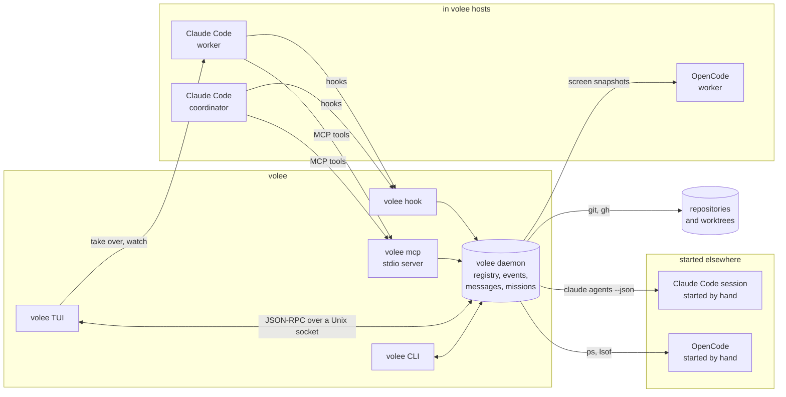

# Architecture overview

This page explains how volee is built and why. Each significant choice has an
architecture decision record (ADR) in [Decisions](../adr/README.md).

## What volee is for

Developers now run many coding agents at once: several Claude Code sessions,
each in its own git worktree, sometimes coordinated by another agent. volee
answers four questions at a glance, from a terminal:

1. **Who is running?** Every agent on the machine, with its state, its repo,
   its branch and its worktree.
2. **Who needs me?** Permission prompts, questions and finished work, sorted
   by urgency.
3. **What did they do?** Commits, diffs, pushed or not, pull request and checks.
4. **Who talks to whom?** Messages between agents and with you, as threads and
   as a living graph.

It also runs **missions**: a goal that spans one or more repositories, split
by a coordinator agent and delivered by worker agents.

## Principles

- **An agent is not a pane.** An agent is a unit of work done by one or more
  harness sessions. Panes, tabs and terminals are only places where an agent
  can be shown. See [ADR 0001](../adr/0001-agent-identity.md).
- **A host holds each agent's terminal.** Every agent volee launches runs
  in a volee host: one small process per agent that holds its
  pseudo-terminal and its exact screen, and survives the interface, the
  daemon and the terminal that started it. Any number of watchers read the
  screen without changing it, and one person at a time takes the agent
  over. See [Hosts](hosts.md) and
  [ADR 0019](../adr/0019-a-host-process-holds-each-agent-terminal.md), which
  supersedes ADR 0002.
- **Every agent on the machine, read only unless volee runs it.** Agents
  started elsewhere are found through their harness and the process table,
  and shown; volee never types into them, resizes or stops them. Adopting
  one moves its conversation into a host. See
  [ADR 0023](../adr/0023-every-agent-on-the-machine.md).
- **One source of truth.** A small daemon (`volee daemon`) keeps the registry, the
  event log, the messages and the missions in SQLite. Every client (the TUI,
  the CLI, the MCP server used by agents) reads and writes through it. See
  [ADR 0003](../adr/0003-daemon-and-event-log.md).
- **Evidence before action.** volee never removes a worktree, stops a session
  or closes a mission on a guess. Cleanup needs delivery evidence (a merged
  branch, a merged pull request, a delivered report). See
  [ADR 0011](../adr/0011-safety-and-delivery-evidence.md).
- **Your tools, not ours.** Multiplexers, editors and git clients are optional
  integrations. volee works in any terminal and never asks you to install
  lazygit, a specific editor or a specific multiplexer.

## Components

Everything ships as **one binary**, `volee`, with subcommands:

| Command | Role |
| --- | --- |
| `volee` | Opens the TUI. Starts the daemon if needed. |
| `volee daemon run` | Runs the daemon in the foreground (other commands start it in the background when needed). |
| `volee daemon install` | Starts the daemon at login, on request only. |
| `volee spawn`, `volee mission ...` | Launch agents and missions. |
| `volee ls`, `volee msg send`, `volee diff`, `volee tidy` | Scriptable views, messaging and cleanup. |
| `volee attach`, `volee adopt` | Take an agent over in this terminal; move an agent volee does not host into a host. |
| `volee host ...` | Run any command line in a host, list, watch, take over and stop hosts. The daemon starts every agent through `volee host spawn`, which runs `volee host run` detached. |
| `volee hook <event>` | Called by Claude Code hooks of the agents volee launched. |
| `volee mcp` | MCP server over stdio, used by agents to talk to each other. |

## Sources of truth

The daemon merges these sources into one model. Each source is authoritative
for one kind of fact:

| Source | Authoritative for | How |
| --- | --- | --- |
| volee hosts | The screen of every agent volee runs, whether its program still runs and how it ended; the state of hosted agents whose harness has no hooks (OpenCode) | The daemon knows each agent's host from its launch, reads the host's record, and takes screen snapshots through its socket ([Hosts](hosts.md)). |
| Hooks of agents volee launched | Fine-grained state, tools in use, last message, files touched | Per-agent `--settings` file whose hooks call `volee hook`. User settings are never edited. |
| `claude agents --json --all` | Every Claude Code session on the machine, including the ones volee did not launch | Polled and reconciled. Documented by Claude Code as the supported way to read session state. |
| The process table | OpenCode agents started elsewhere, with their directory | `ps`, then `lsof` for the directories, once per discovery round ([ADR 0023](../adr/0023-every-agent-on-the-machine.md)). |
| tuios and tmux (optional) | Which pane shows a Claude Code session started by hand in it, and that pane's screen | Matched by the session id the multiplexer recorded or by process ancestry, never by title ([ADR 0015](../adr/0015-tuios-location-adapter.md)). |
| git | Worktrees, branches, commits, diffs, push state | `git` CLI behind a trait, triggered by events and a slow timer. |
| GitHub CLI (`gh`, optional) | Pull requests and checks | Polled slowly, only for branches with agents. |

Hook events are written to an append-only event log first, then folded into
the current state. When the daemon is not running, `volee hook` appends to a
spool file that the daemon ingests at start, so no event is lost.

## Talking to agents

volee hands messages to Claude Code agents through three documented
mechanisms, never by typing into their terminal, even when it hosts them.
All three were verified on Claude Code 2.1.319 (see
[ADR 0006](../adr/0006-messaging.md)):

| Agent is | volee delivers by | Effect |
| --- | --- | --- |
| Working | A `Stop` hook that returns `decision: "block"` with the pending messages | The agent reads them at the end of its turn and continues. |
| Idle, process alive | An `asyncRewake` hook (on `Stop`, and on `SessionStart` for a session that waits at its prompt) that waits for a message, then exits with status 2 | The idle agent wakes up with the message, same session. |
| Stopped (its program ended, or Claude Code reaped an idle background session after about an hour) | `claude --resume=<session>` with the message, in a new volee host | The conversation continues in a new host, in the agent's worktree, linked to the same agent. Never for an agent you stopped (until you write to it) or whose mission is over. |

OpenCode has no hooks: a message waits until the agent stops, then volee
resumes it in a new host with `opencode --session <id> --prompt <messages>`.

Agents send messages through the `volee` MCP server (`send_message`,
`read_messages`, `list_agents`...), which works for any harness that speaks
MCP. That is how an agent of one AI can talk to an agent of another.

## After a reboot

A reboot ends every host, but the harness has saved the conversation and
the worktree is on disk. When the daemon starts, it looks for agents whose
host is gone without recording an end, and resumes each one in a new host
with its harness's resume command: a working agent with a first prompt that
says the machine restarted, an idle one at its prompt. Agents you stopped,
agents of a mission that is over, agents that were done or failed, and
agents whose host died again soon after such a resume (a crash, not a
reboot) stay down. The
daemon starts the first time volee is used, or at login after
`volee daemon install`. See
[ADR 0024](../adr/0024-agents-come-back-after-a-reboot.md).

## Missions

A mission has a **coordinator** and **workers**. The coordinator is split in
two on purpose (see [ADR 0007](../adr/0007-missions.md)):

- a **supervisor program** inside the daemon waits, retries and checks delivery
  evidence. It costs no tokens while it waits.
- a **coordinator agent** (an LLM) splits the goal, spawns workers through MCP,
  answers their questions and writes the final report. It is woken by
  messages; it never polls.

Missions are of two kinds: **change** missions deliver branches and pull
requests; **analysis** missions deliver reports.

## Crates

| Crate | Responsibility | Depends on |
| --- | --- | --- |
| `volee-core` | Domain model and pure logic: agents, roles, states, messages, missions, delivery verdicts. No IO. | none |
| `volee-config` | The configuration file: parsing, defaults and checks. | none |
| `volee-proto` | IPC messages and JSON-RPC framing shared by the daemon and its clients. | core |
| `volee-store` | SQLite storage, migrations, event log and projections. | core |
| `volee-git` | Git queries behind a trait (CLI implementation). | core |
| `volee-harness` | Harness profiles ([ADR 0022](../adr/0022-harness-profiles.md)). Claude Code: launch and resume in a host, discover, hooks, logs of background sessions, stop, wake. OpenCode: launch and resume in a host, find its processes. | core |
| `volee-term` | Terminal emulation with libghostty-vt ([ADR 0020](../adr/0020-libghostty-vt-emulates-terminals.md)): a screen fed with bytes, rendered back as VT sequences, answering terminal queries, drawn into a ratatui buffer. | none |
| `volee-host` | The volee host ([ADR 0019](../adr/0019-a-host-process-holds-each-agent-terminal.md)): the process that holds an agent's terminal, its socket protocol, its record, watchers, and taking over with Ctrl+Q. | term |
| `volee-mux` | Location adapters ([ADR 0015](../adr/0015-tuios-location-adapter.md)): the multiplexer panes agents run in. tuios and tmux: find, capture, focus. | core, harness |
| `volee-daemon` | The daemon: reconcilers, message router, mission supervisor, launches and their setup commands, adoption, resumes after a reboot. | core, config, proto, store, git, harness, host, mux |
| `volee-mcp` | MCP server exposed to agents. | core, proto |
| `volee-tui` | The ratatui interface, and the wall of screens. | core, proto, host, term |
| `volee-cli` | The `volee` binary and its subcommands. | all |

The dependency graph points inward: `volee-core` knows nothing about Claude
Code, SQLite, git or terminals. That keeps the domain testable without IO and
leaves room for more harnesses.

## Files on disk

volee follows the XDG base directory layout on every platform:

| Path | Content |
| --- | --- |
| `~/.config/volee/config.toml` | Agent defaults, repositories, summaries, theme, keymap |
| `~/.config/volee/themes/*.toml` | Your themes |
| `~/.local/state/volee/volee.db` | Registry, events, messages, missions (SQLite, WAL) |
| `~/.local/state/volee/logs/` | Daemon logs |
| `~/.local/state/volee/agents/<id>/` | Per-agent hook settings and MCP config |
| `~/.local/state/volee/hosts/` | One socket, record and log per host (`<id>.sock`, `<id>.json`, `<id>.log`), user-only permissions ([Hosts](hosts.md)) |
| `<repository>/.claude/worktrees/<name>` | Worktrees created by volee, inside each repository ([ADR 0013](../adr/0013-worktrees-live-in-their-repository.md)) |
| `$XDG_RUNTIME_DIR/volee.sock` (or the state directory) | Daemon socket, user-only permissions |

## Performance budget

- Daemon idle: under 1 % CPU and under 30 MB of memory. Measured on the
  0.1 release build: 9.4 MB, and 0.03 s of CPU in two minutes.
- Session discovery: each `claude agents --json --all` costs about 0.17 s
  of CPU and starts a Node process of about 150 MB. Listing every two
  seconds would cost about 8.5 % of a core for as long as the interface is
  open, so the daemon lists every two seconds only after a listing that
  changed something, backs off to every ten seconds (about 1.7 % of a core)
  while nothing changes, and lists every thirty seconds (about 0.6 %) when
  no interface is open.
- TUI frame: under 5 ms at 200x60. Animation ticks only run while something
  moves.
- Git is never polled more than once a minute per worktree, unless an event
  (an edit, a commit, a push) asks for it.
