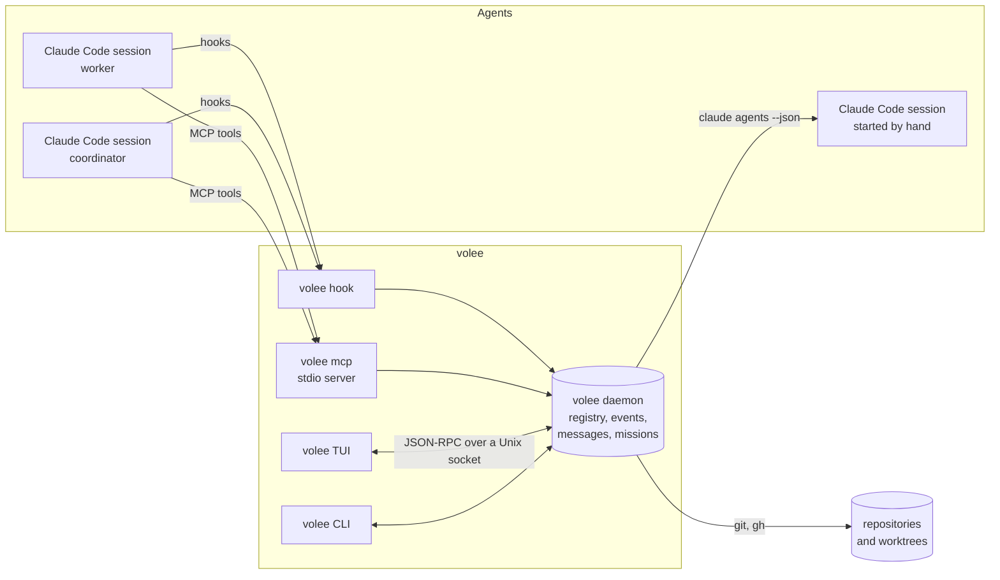

# Architecture overview

This page explains how volee is built and why. Each significant choice has an
architecture decision record (ADR) in [Decisions](../adr/README.md).

## What volee is for

Developers now run many coding agents at once: several Claude Code sessions,
each in its own git worktree, sometimes coordinated by another agent. volee
answers four questions at a glance, from a terminal:

1. **Who is running?** Every agent on the machine, with its state, its repo,
   its branch and its worktree.
2. **Who needs me?** Permission prompts, questions and finished work, sorted
   by urgency.
3. **What did they do?** Commits, diffs, pushed or not, pull request and checks.
4. **Who talks to whom?** Messages between agents and with you, as threads and
   as a living graph.

It also runs **missions**: a goal that spans one or more repositories, split
by a coordinator agent and delivered by worker agents.

## Principles

- **An agent is not a pane.** An agent is a unit of work done by one or more
  harness sessions. Panes, tabs and terminals are only places where an agent
  can be shown. See [ADR 0001](../adr/0001-agent-identity.md).
- **volee does not own agent processes.** The harness does. For Claude Code,
  agents run as background sessions (`claude --bg`) supervised by Claude
  Code's own daemon, so they survive when every window is closed. See
  [ADR 0002](../adr/0002-harness-owns-processes.md).
- **One source of truth.** A small daemon (`volee daemon`) keeps the registry, the
  event log, the messages and the missions in SQLite. Every client (the TUI,
  the CLI, the MCP server used by agents) reads and writes through it. See
  [ADR 0003](../adr/0003-daemon-and-event-log.md).
- **Evidence before action.** volee never removes a worktree, stops a session
  or closes a mission on a guess. Cleanup needs delivery evidence (a merged
  branch, a merged pull request, a delivered report). See
  [ADR 0011](../adr/0011-safety-and-delivery-evidence.md).
- **Your tools, not ours.** Multiplexers, editors and git clients are optional
  integrations. volee works in any terminal and never asks you to install
  lazygit, a specific editor or a specific multiplexer.

## Components

Everything ships as **one binary**, `volee`, with subcommands:

| Command | Role |
| --- | --- |
| `volee` | Opens the TUI. Starts the daemon if needed. |
| `volee daemon run` | Runs the daemon in the foreground (other commands start it in the background when needed). |
| `volee spawn`, `volee mission ...` | Launch agents and missions. |
| `volee ls`, `volee msg send`, `volee diff`, `volee tidy` | Scriptable views, messaging and cleanup. |
| `volee hook <event>` | Called by Claude Code hooks of the agents volee launched. |
| `volee mcp` | MCP server over stdio, used by agents to talk to each other. |

## Sources of truth

The daemon merges four sources into one model. Each source is authoritative for
one kind of fact:

| Source | Authoritative for | How |
| --- | --- | --- |
| Hooks of agents volee launched | Fine-grained state, tools in use, last message, files touched | Per-agent `--settings` file whose hooks call `volee hook`. User settings are never edited. |
| `claude agents --json --all` | Every Claude Code session on the machine, including the ones volee did not launch | Polled and reconciled. Documented by Claude Code as the supported way to read session state. |
| git | Worktrees, branches, commits, diffs, push state | `git` CLI behind a trait, triggered by events and a slow timer. |
| GitHub CLI (`gh`, optional) | Pull requests and checks | Polled slowly, only for branches with agents. |

Hook events are written to an append-only event log first, then folded into
the current state. When the daemon is not running, `volee hook` appends to a
spool file that the daemon ingests at start, so no event is lost.

## Talking to agents

There is no supported API to type a prompt into a running Claude Code
background session. volee uses three documented mechanisms, all verified on
Claude Code 2.1.319 (see [ADR 0006](../adr/0006-messaging.md)):

| Agent is | volee delivers by | Effect |
| --- | --- | --- |
| Working | A `Stop` hook that returns `decision: "block"` with the pending messages | The agent reads them at the end of its turn and continues. |
| Idle, process alive | An `asyncRewake` `Stop` hook that waits for a message, then exits with status 2 | The idle agent wakes up with the message, same session. |
| Stopped (idle sessions are reaped after about an hour) | `claude --bg --resume <session>` with the message | The conversation continues in a new session that volee links to the same agent. |

Agents send messages through the `volee` MCP server (`send_message`,
`read_messages`, `list_agents`...), which works for any harness that speaks
MCP. That is how an agent of one AI can talk to an agent of another.

## Missions

A mission has a **coordinator** and **workers**. The coordinator is split in
two on purpose (see [ADR 0007](../adr/0007-missions.md)):

- a **supervisor program** inside the daemon waits, retries and checks delivery
  evidence. It costs no tokens while it waits.
- a **coordinator agent** (an LLM) splits the goal, spawns workers through MCP,
  answers their questions and writes the final report. It is woken by
  messages; it never polls.

Missions are of two kinds: **change** missions deliver branches and pull
requests; **analysis** missions deliver reports.

## Crates

| Crate | Responsibility | Depends on |
| --- | --- | --- |
| `volee-core` | Domain model and pure logic: agents, roles, states, messages, missions, delivery verdicts. No IO. | none |
| `volee-config` | The configuration file: parsing, defaults and checks. | none |
| `volee-proto` | IPC messages and JSON-RPC framing shared by the daemon and its clients. | core |
| `volee-store` | SQLite storage, migrations, event log and projections. | core |
| `volee-git` | Git queries behind a trait (CLI implementation). | core |
| `volee-harness` | Harness adapters. Claude Code first: spawn, discover, hooks, logs, attach, wake. | core |
| `volee-daemon` | The daemon: reconcilers, message router, mission supervisor. | core, config, proto, store, git, harness |
| `volee-mcp` | MCP server exposed to agents. | core, proto |
| `volee-tui` | The ratatui interface. | core, proto |
| `volee-cli` | The `volee` binary and its subcommands. | all |

The dependency graph points inward: `volee-core` knows nothing about Claude
Code, SQLite, git or terminals. That keeps the domain testable without IO and
leaves room for more harnesses.

## Files on disk

volee follows the XDG base directory layout on every platform:

| Path | Content |
| --- | --- |
| `~/.config/volee/config.toml` | Agent defaults, repositories, summaries, theme, keymap |
| `~/.config/volee/themes/*.toml` | Your themes |
| `~/.local/state/volee/volee.db` | Registry, events, messages, missions (SQLite, WAL) |
| `~/.local/state/volee/logs/` | Daemon logs |
| `~/.local/state/volee/agents/<id>/` | Per-agent hook settings and MCP config |
| `<repository>/.claude/worktrees/<name>` | Worktrees created by volee, inside each repository ([ADR 0013](../adr/0013-worktrees-live-in-their-repository.md)) |
| `$XDG_RUNTIME_DIR/volee.sock` (or the state directory) | Daemon socket, user-only permissions |

## Performance budget

- Daemon idle: under 1 % CPU and under 30 MB of memory.
- TUI frame: under 5 ms at 200x60. Animation ticks only run while something
  moves.
- Git is never polled more than once a minute per worktree, unless an event
  (an edit, a commit, a push) asks for it.
