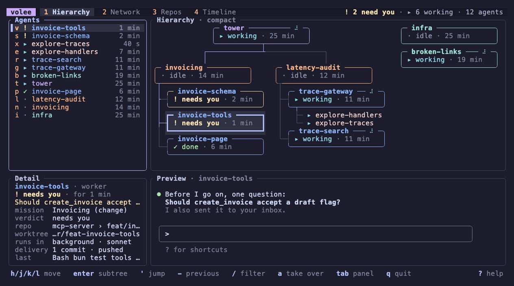
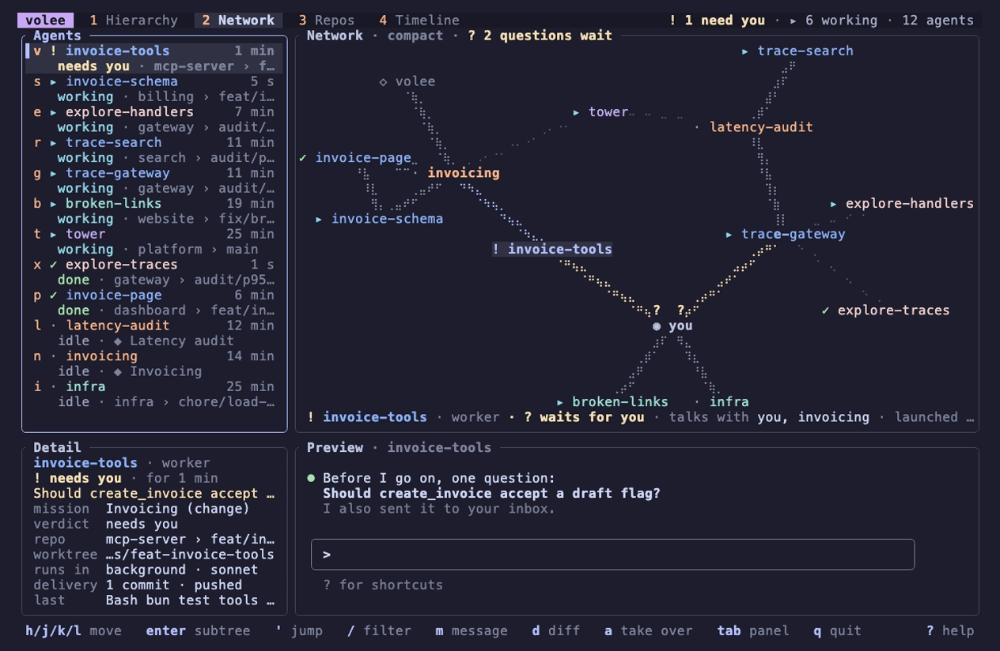
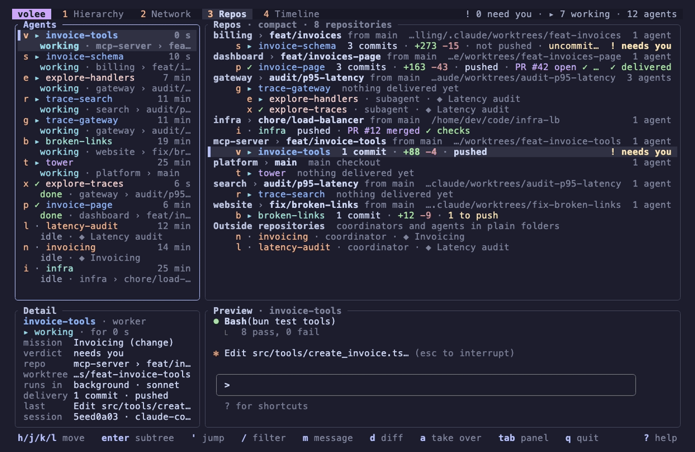
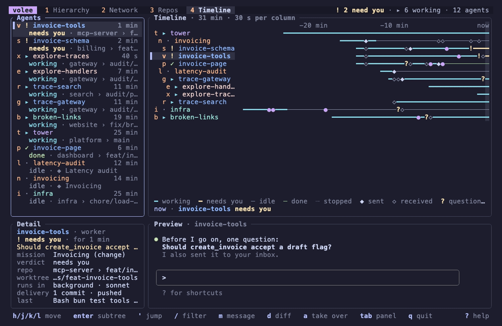

# The interface

`volee` opens one screen that shows every agent on your machine and what it
needs from you. To try it without any agent running, start the demo, a
simulated team of agents that changes every few seconds:

```sh
volee demo
```



## Starting volee

```sh
volee
```

`volee` with no command connects to the [daemon](cli.md#the-daemon),
starting it in the background when it does not run yet, and shows every
agent it knows: the Claude Code sessions it finds on the machine, wherever
they were started, and the agents volee launched itself. The daemon looks
for sessions as soon as the interface opens, then every two seconds while it
stays open (every thirty seconds when no interface is open), so new sessions
show up within a couple of seconds; nothing needs to be configured first.

Everything on the screen comes from the daemon, and so do the actions:

| What | What the daemon uses |
| --- | --- |
| The agents, their states and messages | Its own records, kept up to date as sessions come and go. |
| The preview of an agent's screen | Claude Code, which replays the session's output (`claude logs`). |
| An agent's changes (`d`) | git, in the agent's worktree or folder. |
| Taking over an agent (`a`) | Claude Code, which attaches the session (`claude attach`). |
| Writing to an agent (`m`) | Its own records and the agent's hooks. |

When the daemon cannot do something, because Claude Code or git is
missing, because the agent runs in a terminal of its own, or because the
daemon is older than the interface, volee says so in a sentence where the
result would be, such as "No preview: dashboard runs in a terminal of its
own: switch to that terminal to see or control it", and goes on working. If
the daemon stops while volee runs, the top bar shows `offline` and the
screen stops changing; start `volee` again to reconnect.

The theme, the keys and reduced motion come from the `[tui]` table of the
[configuration](configuration.md), as for the demo.

## Layout

```text
  volee  1 Hierarchy  2 Network  3 Repos  4 Timeline      ! 2 need you · ▸ 6 working · 12 agents
╭ Agents ──────────────╮╭ Hierarchy · compact ─────────────────────────────────────────────────╮
│▌v ! invoice-tools    ││              ╭─ tower ──────── ⠹ ─╮                                   │
│    needs you · mcp-… ││              ╰─────────┬──────────╯                                   │
│ s ! invoice-schema   ││          ┌─────────────┴──────────────┐                               │
│    needs you · bill… ││ ╭─ invoicing ────────╮      ╭─ latency-audit ────╮                   │
│ x ▸ explore-traces   ││ ╰┬───────────────────╯      ╰┬───────────────────╯                   │
│    …                 ││  ├─┤ ! invoice-schema        ├─┤ ▸ trace-gateway                     │
╰──────────────────────╯╰───────────────────────────────────────────────────────────────────────╯
╭ Detail ──────────────╮╭ Preview · invoice-tools ──────────────────────────────────────────────╮
│ invoice-tools        ││ ⏺ Before I go on, one question:                                       │
│ ! needs you · 1 min  ││   Should create_invoice accept a draft flag?                          │
╰──────────────────────╯╰───────────────────────────────────────────────────────────────────────╯
 h/j/k/l move   enter subtree   ' jump   / filter   m message   a take over   q quit     ? help
```

- **Top bar.** The views, numbered (press the number to switch), and
  counters: how many agents need you, how many work, how many there are.
- **Agents.** Every agent, the most urgent first: those that need you, then
  failed, working, launching, done, idle, stopped and lost. Each row shows
  the agent's jump letter, its state, its name, how long it has been in that
  state, and where it works (`repo › branch`, or its mission).
- **View.** What the tab shows: the [hierarchy](#the-hierarchy) of who
  launched whom, the [network](#the-network) of who talks to whom, the
  [repositories](#the-repositories) with their worktrees and what agents
  delivered, or the [timeline](#the-timeline) of what happened when. The
  selected agent is the same in every view and in the list.
- **Detail.** Facts about the selected agent: role, state and since when,
  its mission and the mission supervisor's verdict on its work, repository
  and branch, worktree, where it runs and with which model, delivery
  evidence, last activity and session.
- **Preview.** The selected agent's terminal screen, kept up to date while
  it works. The bottom of the screen, where the latest output is, stays in
  view; scroll it with `j` and `k` when the panel has the keyboard.
- **Hints.** The keys that apply to the panel that has the keyboard. They
  come from the same table as the help (`?`), so they are always right.

Panel sizes depend only on the size of the terminal and on the view: moving
around never makes anything jump. Below 100 columns or 28 rows, the view
makes room. On the hierarchy tab, the agents panel shows the hierarchy as an
indented tree, next to the detail and the preview; the network, the
repositories and the timeline take the right side of the screen, next to
the agents and the detail. The smallest supported terminal is 80x24.

## States

Every state has a glyph and a word, so you can read it without colors. A
spinner turns on the cards of working agents, as an extra, unless
`reduced_motion` is set.

| Glyph | Word | Meaning |
| --- | --- | --- |
| `!` | needs you | Waits for a person: a permission, a question or a dialog. |
| `▸` | working | Running a turn. |
| `…` | launching | Started by volee, not seen running yet. |
| `✓` | done | Finished its last task. |
| `·` | idle | Alive, waiting for its next instruction. |
| `✗` | failed | Ended with an error. |
| `■` | stopped | Its process stopped; the conversation can be resumed. |
| `∅` | lost | volee cannot find it any more. Never treated as done. |

## The hierarchy

The hierarchy shows who launched whom. Lead agents sit at the top, then the
coordinators of their missions, then the workers. Sessions volee did not
launch come last, on their own. Subagents hang under their parent's card as
one-line satellites. The path from the selected card up to its root is
highlighted.

A full card shows, from top to bottom: the name, the role and a spinner on
its border; the state, for how long, and a sparkline of the last minutes of
activity; the repository and branch (the mission, for a coordinator); what
the agent does or waits for; and its delivery (`3 commits · PR #42 ✓`), its
mission's progress for a coordinator, or its scope for a lead.

When a mission has more workers than the width allows, they are stacked in
a column under their coordinator, so the tree stays readable instead of
scrolling.

### Zoom

The hierarchy has three levels of detail: full **cards**, **compact** cards
with only the state, and **dots** with a glyph and a name. volee picks the
most detailed level that fits the panel; `+` and `_` move to more or less
detail and keep it, `0` lets volee choose again. When the tree is larger
than the panel, it scrolls to keep the selection in view, arrows on the
border tell where it goes on, and the mouse wheel scrolls it (with Shift,
sideways).

`Enter` shows only the selected agent and its descendants, with more room
for each card; `Esc` goes back to the whole hierarchy.

## The network



The network shows who talks to whom. Every agent is a node, whatever its
harness (Claude Code, Codex CLI...) or its mission, and whether volee
launched it or not; you and volee itself, the mission supervisor, join as
soon as they take part in a conversation.

- A **line** joins two parties that exchanged messages, in either
  direction. It is thicker when they talked a lot lately: each message
  counts less as it ages.
- A **faint dashed line** joins an agent to the agent that launched it.
- A question that **waits for its answer** is drawn in the question color,
  with a `?` next to the one who must answer. The title counts them.
- When a message is posted, a **pulse** `●` travels along its line from the
  sender to each recipient, in about a second.
- The selected agent's lines are highlighted and its neighbours' names are
  in bold. The line under the graph tells which questions it waits for or
  owes, who it talks with, who launched it and whom it launched.

Lines follow the routes volee allows
([ADR 0006](../adr/0006-messaging.md)): agents of a mission write to each
other freely; otherwise an agent writes to its parent, its children, its
mission's coordinator or the lead who asked for the mission, and to you. So
a conversation between two missions goes through their coordinators and
the lead, or through you, and a session volee did not launch talks with
you: the picture shows who relays what.

Agents that talk end up close together, whatever their mission: positions
come from a force-directed layout (linked agents attract each other, all
agents push each other away). It is computed only when an agent or a new
pair of correspondents appears, never while you watch, and it starts from
the previous positions, so a newcomer moves the others little. Agents that
do not match the filter are dimmed.

Like the hierarchy, the network has three levels of detail: **cards** with
the name and the state, **compact** labels with the state's glyph and the
name, and **dots** with the glyph and the agent's jump letter, the one in
the list, so `'` and that letter selects it. In dots, the selected agent's
name is written next to its dot. volee picks the most detailed level whose
nodes fit without overlapping; `+`, `_` and `0` work as in the hierarchy.
`h`, `j`, `k` and `l` move to the nearest agent in that direction, `g` and
`G` to the top-left and the bottom-right ones.

With `reduced_motion = true` in the [configuration](configuration.md#tui),
a new message lights up its whole line for a moment instead of travelling
along it, and spinners stop.

## The repositories



The repositories view shows where agents work and what they delivered.
Repositories come first, sorted by name, then their worktrees (the main
checkout first) with the branch checked out, the branch it started from and
the worktree's directory; a repository with a single worktree takes one
line. Under each worktree come its agents, their subagents under them.
Coordinators and agents outside any repository come last.

Every agent shows its delivery evidence: commits ahead of its base, lines
added and removed, whether they are pushed, its pull request and the checks,
a merge, a delivered report, uncommitted changes. For a worker of a
mission, the supervisor's last **verdict** sits at the right (`✓ delivered`,
`! needs you`, `✗ not delivered`...); a coordinator shows its mission's
progress instead.

A worktree that [`volee tidy`](cli.md#tidying-worktrees) would remove is
marked **`✓ safe to tidy`**: its work landed (merged into its base, merged
through a pull request, or reported), it has no uncommitted changes, its
agent does not run, volee checked the work since the agent's last change,
and volee launched the agent in a worktree it created. It is the same rule,
from [ADR 0011](../adr/0011-safety-and-delivery-evidence.md). Otherwise the
full level says why the worktree is kept, such as `keep: busy, not landed`
or `keep: not launched by volee`. The view only tells; it removes nothing.
The title counts the worktrees that are safe to tidy.

Three levels of detail: **full** (a line for the agent, a line for its
evidence), **compact** (one line per agent, the evidence after the name)
and **names**. volee shows the evidence in full when it fits, on one line
otherwise; `+`, `_` and `0` change the level and give it back to volee.
`j` and `k` move through the agents in the view's order, `h` and `l` jump
to the previous or next repository.

## The timeline



The timeline shows what happened when. Each agent has a lane, in the
hierarchy's order so lanes never jump around, over the last half hour by
default. The present is at the right edge, and the picture slides left as
time passes, one column at a time.

A lane draws the agent's state as a bar: heavy while it works (`━`) or
waits for you (`━` in the color of that state), thin while it is idle or
done (`─`), dotted once it stopped (`┄`). Marks tell what happened; when
several fall in the same column, the one a person most needs to see wins:

| Mark | Meaning |
| --- | --- |
| `!` | The agent started to need you. |
| `✓`, `✗` | It finished, or failed. |
| `?` | It asked a question. |
| `◆`, `◇` | It sent a message, or received one. |
| `●` | Its delivery moved: commits, push, pull request, checks, merge, report. |
| `◉` | Its mission's supervisor judged its work. |

A **cursor** scrubs through time. `h` and `l` move it one column back or
forward, `[` and `]` jump to the selected agent's previous or next event,
and a click on a lane moves it there. The line under the lanes reads the
cursor: when, the selected agent's state then, and what it did at that
moment (the question it asked, the answer it received, the pull request
that merged...). Going back further than the lanes reach slides the window
back with the cursor; `Esc` brings it to the present again. `+` and `_`
make the time scale finer or coarser, from a second to an hour per column;
`0` comes back to the present and the default scale.

## Moving around

- `j`, `k` and the arrows move through the list. In the hierarchy, `h`,
  `j`, `k` and `l` move through the tree as drawn: down to satellites and
  children, up to the parent, sideways to the nearest card. In the network
  they move to the nearest agent on screen; in the repositories and the
  timeline, `j` and `k` follow the view's order.
- Every agent has a letter, shown in the list. Press `'` then the letter
  to jump to it, from anywhere: two keys to reach any agent.
- `-` goes back to the agent selected before, and again to return.
- `/` filters by name, repository, branch or mission, as you type. The
  hierarchy and the network dim the agents that do not match; the list,
  the repositories and the timeline hide them. `Enter` keeps the filter,
  `Esc` clears it.
- `Tab` moves the keyboard to the next panel. Clicking a row, a card, a
  node, a lane or a tab selects it.

`Esc` closes or leaves one thing at a time (the help, the timeline's
cursor, the subtree, the filter, then the panel), and never quits volee.

## Writing to an agent

`m` opens the composer on the selected agent. Write your message (Markdown
is fine), choose its kind with `Tab` (`note`, `question`, `answer`,
`contract` or `alert`) and send it with `Enter`. `Alt+Enter` or `Ctrl+J`
starts a new line, and pasting several lines keeps them.

When the agent asked you a question that you have not answered, the
composer opens as the answer to it and shows the question; volee then links
the two, so the question stops waiting. A message reaches an agent volee
launched at the end of its turn, and wakes it when it is idle. Sessions
started outside volee cannot receive messages yet; the composer says so.

`Esc` closes the composer and keeps what you wrote: the hint line shows
`✎ draft to <agent>`, and `m` brings it back, addressed to the agent
selected then. Quitting with a draft asks first.

## Changes

`d` shows the selected agent's changes against the branch it started
from: first a summary (`git diff --stat`), then the full patch with `f`. `j`
and `k` scroll, `r` loads them again, and `Esc` or `d` closes the window. A
very long patch stops at a line that says so; the rest is in the agent's
worktree.

## Taking over an agent

`a` takes over the selected agent in this terminal: volee asks the daemon
how, steps aside and runs the command it gives, such as `claude attach` on
the agent's session, after printing how to come back. Leave the session
with `Ctrl+Z` and volee comes back, on the same agent. Agents running in
another terminal cannot be attached from here; volee tells you where they
are instead.

## Keys

`q` quits at once, unless a message you started would be lost: then volee
asks first. The tables below are generated from the keymap, like the help
and the hints.

To move an action to other keys, name it in the `[tui.keys]` table of the
[configuration](configuration.md). An override replaces every key of the
action, in every panel; keys are written like `q`, `ctrl-c`, `shift-tab`,
`enter` or `f5`, and two actions cannot share a key in the same panel:

```toml
[tui.keys]
take-over = "ctrl-a"
```

<!-- keys:start -->
### Everywhere

| Keys | What it does | Action |
| --- | --- | --- |
| `'` | jump to an agent: press ' then its letter | `jump` |
| `-` | back to the agent selected before | `jump-back` |
| `/` | filter agents by name, repository, branch or mission | `filter` |
| `m` | write a message to the selected agent | `message` |
| `d` | show the selected agent's changes | `diff` |
| `a` | take over the selected agent in this terminal | `take-over` |
| `tab` | focus the next panel | `next-pane` |
| `shift-tab` | focus the previous panel | `previous-pane` |
| `1` | show the hierarchy | `show-hierarchy` |
| `2` | show the network | `show-network` |
| `3` | show repositories and worktrees | `show-repos` |
| `4` | show the timeline | `show-timeline` |
| `?` | show or hide the keys | `help` |
| `esc` | close, cancel or go back (never quits) | `back` |
| `q`, `ctrl-c` | quit volee (asks first when a draft would be lost) | `quit` |

### Agents list

| Keys | What it does | Action |
| --- | --- | --- |
| `h`, `←` | parent agent | `left` |
| `j`, `↓` | next agent | `down` |
| `k`, `↑` | previous agent | `up` |
| `l`, `→` | first child agent | `right` |
| `g`, `home` | first agent | `first` |
| `G`, `end` | last agent | `last` |
| `enter` | show the agent's subtree in the hierarchy | `focus-subtree` |

### Hierarchy

| Keys | What it does | Action |
| --- | --- | --- |
| `h`, `←` | card on the left | `left` |
| `j`, `↓` | card below | `down` |
| `k`, `↑` | card above | `up` |
| `l`, `→` | card on the right | `right` |
| `g`, `home` | first card | `first` |
| `G`, `end` | last card | `last` |
| `enter` | show only the selected agent and its descendants | `focus-subtree` |
| `+`, `=` | more detail on cards | `zoom-in` |
| `_` | less detail on cards | `zoom-out` |
| `0` | choose the detail level from the size | `zoom-auto` |

### Network

| Keys | What it does | Action |
| --- | --- | --- |
| `h`, `←` | agent on the left | `left` |
| `j`, `↓` | agent below | `down` |
| `k`, `↑` | agent above | `up` |
| `l`, `→` | agent on the right | `right` |
| `g`, `home` | first agent, top left | `first` |
| `G`, `end` | last agent, bottom right | `last` |
| `+`, `=` | more detail on agents | `zoom-in` |
| `_` | less detail on agents | `zoom-out` |
| `0` | choose the detail level from the size | `zoom-auto` |

### Repositories

| Keys | What it does | Action |
| --- | --- | --- |
| `j`, `↓` | next agent | `down` |
| `k`, `↑` | previous agent | `up` |
| `h`, `←` | previous repository | `left` |
| `l`, `→` | next repository | `right` |
| `g`, `home` | first agent | `first` |
| `G`, `end` | last agent | `last` |
| `+`, `=` | more detail per agent | `zoom-in` |
| `_` | less detail per agent | `zoom-out` |
| `0` | choose the detail level from the size | `zoom-auto` |

### Timeline

| Keys | What it does | Action |
| --- | --- | --- |
| `j`, `↓` | next agent | `down` |
| `k`, `↑` | previous agent | `up` |
| `h`, `←` | move the cursor back in time | `left` |
| `l`, `→` | move the cursor forward in time | `right` |
| `[` | cursor to the selected agent's previous event | `previous-event` |
| `]` | cursor to the selected agent's next event | `next-event` |
| `g`, `home` | first agent | `first` |
| `G`, `end` | last agent | `last` |
| `+`, `=` | shorter time span, more detail | `zoom-in` |
| `_` | longer time span | `zoom-out` |
| `0` | back to now and the default time span | `zoom-auto` |

### Detail and preview

| Keys | What it does | Action |
| --- | --- | --- |
| `j`, `↓` | scroll the preview down | `down` |
| `k`, `↑` | scroll the preview up | `up` |
| `r` | refresh the preview | `refresh` |

### Filter prompt

| Keys | What it does | Action |
| --- | --- | --- |
| `enter` | keep the filter and close the prompt | `apply` |
| `esc` | clear the filter and close the prompt | `back` |
| `ctrl-c` | quit volee | `quit` |

### Message composer

| Keys | What it does | Action |
| --- | --- | --- |
| `enter` | send the message | `send` |
| `alt-enter`, `ctrl-j` | start a new line | `new-line` |
| `tab` | next kind of message | `next-kind` |
| `shift-tab` | previous kind of message | `previous-kind` |
| `esc` | close the composer and keep the draft | `back` |
| `ctrl-c` | quit volee (asks first) | `quit` |

### Changes

| Keys | What it does | Action |
| --- | --- | --- |
| `j`, `↓` | scroll down | `down` |
| `k`, `↑` | scroll up | `up` |
| `g`, `home` | top | `first` |
| `G`, `end` | bottom | `last` |
| `f` | switch between the summary and the full patch | `toggle-full` |
| `r` | load the changes again | `refresh` |
| `esc`, `d`, `q` | close the changes | `back` |
| `ctrl-c` | quit volee | `quit` |

### Questions

| Keys | What it does | Action |
| --- | --- | --- |
| `y` | yes | `confirm` |
| `n`, `esc` | no | `back` |
| `ctrl-c` | quit volee without asking again | `quit` |

### Help

| Keys | What it does | Action |
| --- | --- | --- |
| `j`, `↓` | scroll down | `down` |
| `k`, `↑` | scroll up | `up` |
| `esc`, `?`, `q` | close the help | `back` |
| `ctrl-c` | quit volee | `quit` |
<!-- keys:end -->
