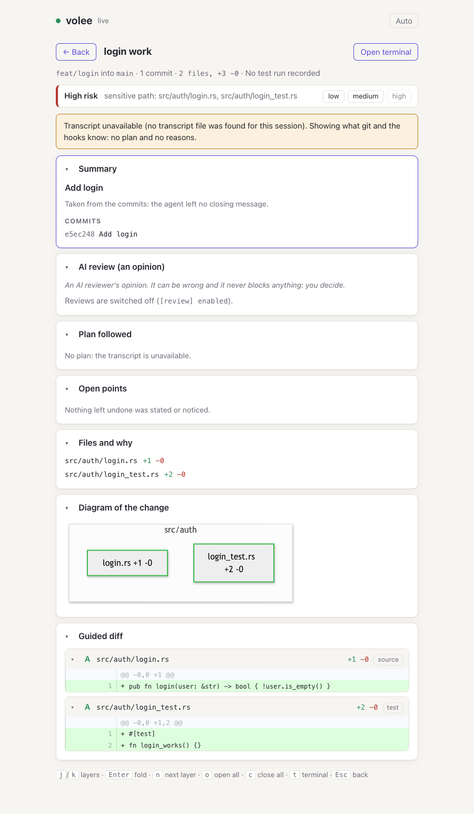
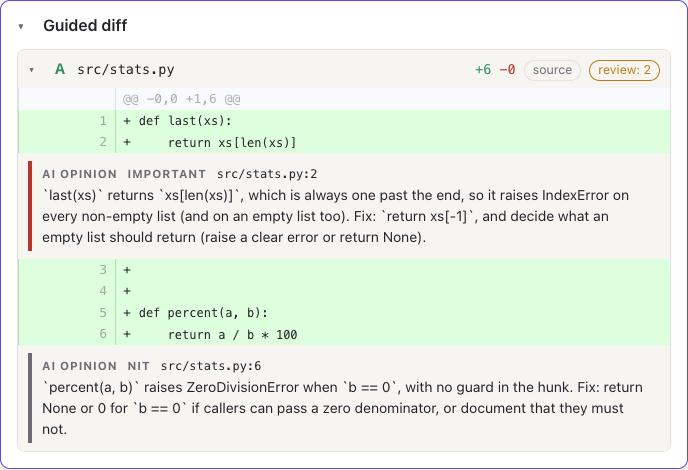
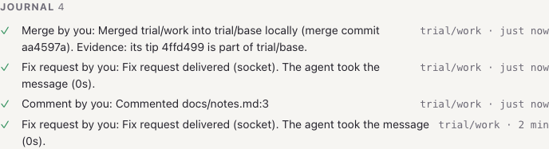

# The interface

`volee ui` opens the inbox in your browser. It is a page served by the daemon
on the loopback interface only, so it needs the daemon to run, and it updates
live through a server-sent event stream: a card appears within about a second
of a hook, and goes when the decision is made, wherever it is made.

The link `volee ui` prints carries an access token in its fragment
(`#token=...`). The page keeps it for the tab and clears the address bar. A page
opened without it says "This page needs its link": run `volee ui` again. The
theme (automatic, light or dark) is a button on the page and is remembered by
the browser.

## The inbox

Cards are sorted by urgency. Held decisions come first, then agents waiting for
something else, then finished work. Within each group the one that has waited
longest is first. When nothing needs you the page says so, and counts the
agents that are running.

A **banner** appears when a rules file is broken (file, line and message). Every
answer is then the safest one until it is fixed.

### A permission

A permission card shows the tool and its input (**Full request** shows all of
it), the agent, its repository and branch, and the time left before the hold
runs out.

| Button | Key | Effect |
| --- | --- | --- |
| Allow | `a` | Claude Code runs the tool |
| Allow and remember | `r` | Allow, with the first rule Claude Code suggested (a `permission_suggestions` entry), so it does not ask again |
| Deny | `d` | Asks for a reason, which the model reads |
| Open terminal | `t` | Focuses the agent's terminal (only with an adapter, see below) |
| Ask in terminal | | Hands the request back to Claude Code's own dialog |

If you answer in the terminal first, the card disappears. If you answer on the
page after that, the page says the request is gone.

### A question

A question card lists each question with its proposed answers. `1` to `9`
choose an option, `o` goes to the free-text field, `Enter` sends, `d` denies
with a reason. A multi-select question accepts several options; they reach the
model joined by a comma and a space, exactly as the terminal records them. While
volee holds a question the terminal shows only a spinner line
(`running PreToolUse hooks...`): the hold is short on purpose, and when it runs
out the normal dialog appears.

`AskUserQuestion` and `ExitPlanMode` never become permission cards. The first
becomes a question card; the second stays in the terminal.

### Finished work

A finished-work card shows the agent, the branch and its base, the diff summary
(files, lines added and removed), the risk with its first reason, whether an
AI review ran, and what you may do: **Read the work** (`r` reads the first
card), and the merge button when merging is allowed.

## Reading a change

**Read the work** opens the work screen. It is always available for a known
agent; what could not be read is said inside it.

The header gives the risk and its reasons, with a control to raise or lower it
by hand (`overridden` is shown, and the choice goes away with the next commit),
and the action bar. Below it, the layers. The ones your rules name for the risk
in force start open; the others are one click or one key away.

| Layer | What it holds |
| --- | --- |
| Summary | One line of what changed and why |
| AI review (an opinion) | The findings of `/code-review` by severity, who reviewed, and a Run or Retry button |
| Plan followed | The agent's task list, a plan-mode plan, or, as a last resort, the numbered steps of the prompt (labelled as what was asked, not as a record of what was done) |
| Open points | What the closing message says was not done, plus what volee noticed (unfinished plan steps, a failing last test run, source changed with no test run, uncommitted changes), each saying who noticed |
| Files and why | The files with the reason each was touched, the commands run and their outcome |
| Diagram of the change | Files grouped by folder, with an arrow where a changed file gained an import of another changed file |
| Guided diff | The diff ordered for reading: source, tests, docs, config, then lock and generated files, folded. Findings and your comments sit under their line |

Keys on the work screen: `j` / `k` move between layers, `Enter` folds one, `n`
goes to the next, `o` opens all, `c` closes all, `m` `m` merges, `f` asks for a
fix, `t` opens the terminal, `Esc` goes back.

Git is the truth: the files, the counts, the diff and the diagram come from
`git diff base...branch` (plus uncommitted changes to tracked files when the
branch is checked out). The transcript is commentary: the prompts, the plan, the
reasons. When the transcript cannot be read, the screen says "transcript
unavailable" and shows what git and the hooks know.

## Actions

- **Merge.** One click, and the daemon merges: a pull request is merged through
  `gh` (a draft is marked ready; the method is the repository's `merge`
  setting, else the first one the forge allows); any other repository gets a
  merge commit of the branch into its base in the main checkout, which must have
  the base checked out and be clean. Nothing is forced, no branch is deleted. A
  local merge is checked with the delivery evidence (the tip is part of the
  base), a forge merge by asking the forge again; a merge that cannot be shown
  is reported as failed. A failed merge changes nothing and says why.
- **Automatic merge.** When your rules say yes for a low risk change, in a
  repository your personal file lists in `auto_merge_repos`, the daemon merges
  by itself, once per branch tip, and the journal says it was a rule and why.
  The button says "auto merge not enabled for this repo" otherwise. There is no
  switch on the page, on purpose.
- **Ask for a fix.** The box is prefilled from the selected review findings (the
  important ones start selected) and your line comments, and you edit it
  freely. `Ctrl+Enter` sends it. The first line tells the agent it is a request
  from you, typed in volee and relayed by it. volee checks again, when you send,
  whether the session is alive: a live one gets the message on its messaging
  socket; a stopped one, or one whose socket cannot be used, is resumed in the
  background with the message, and the journal says which way it went. Claude
  Code itself shows a live session the message as sent by "another Claude
  session", which volee cannot change: a model may hesitate over a request that
  contradicts its task. The page says "delivered" only when the
  transcript shows it, or "NOT delivered" and offers the text with a Copy
  button. See [ADR 0041](../adr/0041-actions-on-a-finished-change-and-how-a-fix-reaches-the-agent.md).
- **Comment a line.** Click a line number of the new side of the diff. A comment
  is kept per repository and branch tip: a new commit starts clean. Comments feed
  the fix request.
- **Open in my editor.** The file header offers the editors from your rules (see
  [Rules files](../reference/rules.md#editors)): a GUI editor runs as an external
  command, a terminal editor opens through a terminal adapter. After you save,
  the diff reads again by itself (within a few seconds).
- **Journal.** Every action writes one line, shown on the inbox and under the
  change ("Done on this change").

## Open terminal

volee never reads or types into a terminal. An adapter only locates and focuses
one. The only adapter today is Rex (a terminal multiplexer): it finds
the pane that holds the agent's process (or the only pane in its directory) and
focuses it; Rex refuses unless Remote Control is on, in which case the page
tells you which session to open. When Rex is not installed or its server does
not run, the button is hidden, and so are terminal editors.
