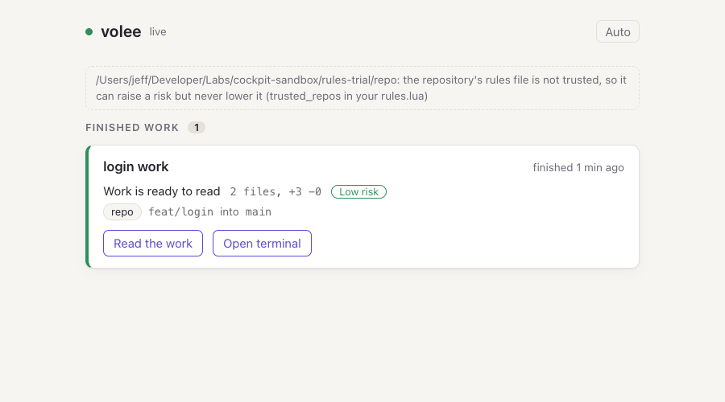

# Introduction

volee is a **control tower for your Claude Code agents**. You run several
agents at once, across repositories. The scarce resource is no longer typing,
it is attention: every agent produces work to read, questions to answer and
permissions to grant, at moments you do not choose. volee watches them, puts
what needs a decision in one inbox in your browser, and lets you decide with as
little reading as the risk allows.

> [!NOTE]
> This documentation describes volee v2, which is not released yet. The latest
> release, 0.18, was a different tool (a terminal interface that launched agents
> and owned their terminals). The [roadmap](project/roadmap.md) says what
> remains before v2.0.0. The decisions of 0.x stay in the
> [decision list](adr/README.md), marked as superseded where v2 replaced them.

## What you get

- **One inbox with three kinds of card.** A **permission** (allow once, allow
  with a rule Claude Code suggested, deny with a reason), a **question**
  (proposed answers first, or your own words) and **finished work**.
- **Finished work read in layers.** One line of summary, then the plan the
  agent followed, its open points, an AI review, a diagram of the change and the
  diff ordered for reading. Each layer opens only if the risk asks for it.
- **Risk you can tune.** Rules in Lua, per repository and per person, decide the
  risk of a change (sensitive paths, migrations, dependencies, size, untested
  code) and with it the layers shown, the review plan and whether a merge may be
  automatic.
- **Actions.** Merge, ask the agent for a fix, comment a line (it becomes the fix
  request), open the file in your own editor. Every action is written to a
  journal.
- **An opinion, never a gate.** The review is Claude Code's own `/code-review`.

## What volee does not do

volee **observes**. It does not launch agents, hold their terminals or type
into them. Claude Code reports what happens through its own hooks, and a
decision goes back through the hook's response. The only thing volee writes to
a session is a fix request you ask for, through Claude Code's documented
messaging socket or a background resume, never keys typed into a terminal.

## Where to go next

- [Installation](guide/installation.md), then [Getting started](guide/getting-started.md):
  start the daemon, hook it to Claude Code, open the inbox.
- [Concepts](guide/concepts.md): the words used on the page.
- [The interface](guide/interface.md): each card and screen.
- [Configuration](guide/configuration.md) and [Rules files](reference/rules.md):
  `config.lua` and `rules.lua`.
- [Architecture overview](architecture/overview.md): how the parts fit, and why
  the [decisions](adr/README.md) were taken.

volee is open source, MIT OR Apache-2.0, built in the open at
[github.com/volee-org/volee](https://github.com/volee-org/volee).
