# Step 9 trial: the actions on a finished change, with real agents

Run on 2026-11-22 against the sandbox repository `cockpit-sandbox/alpha`
(already trusted by Claude Code, no remote). An isolated daemon (own config,
state and data directories in a scratch folder, hook port 47911, own socket),
real interactive `claude --model haiku` sessions (Claude Code 2.1.330) in tmux
and, for the terminal editor, in a Rex window, started with `--settings` that
holds the hooks of that daemon (so `~/.claude.json` and
`~/.claude/settings.json` were never touched). The interface was driven by
headless Chrome through Playwright; each screenshot is one element, so no other
agent is visible. The daemon sees every Claude Code session of the machine
(`claude agents --json` is global): the automatic merge rule used for the trial
is limited to `repo == "alpha"` and a `trial/auto` branch, so no other session
could be merged by it.

The base branch was a throwaway `trial/base` checked out in alpha's main
checkout (a local merge needs the base checked out and clean), with worktrees on
`trial/work`, `trial/auto` and `trial/rex`. All of it was removed afterwards
and alpha is back on `main` at `93795ee`.

| Trial | What happened |
| --- | --- |
| **(a) Ask for a fix** | The agent finished a commit (`docs: add notes`). From the browser, "Ask for a fix" with a typed request. |
| 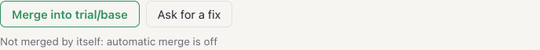 | The action bar of the work screen: merge, ask for a fix, whether it may merge by itself. |
| 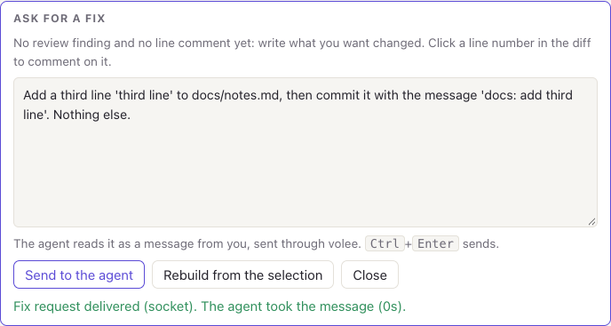 | "Fix request delivered (socket). The agent took the message (0s)." The agent received the line on `/tmp/cc-socks/<pid>.sock` and its transcript shows it; the journal says so. Its hooks recorded a `UserPromptSubmit` starting with "Message from the person you work for, sent through volee". |
| 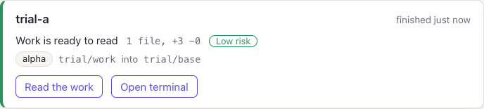 | The agent committed the fix (`docs: add third line`): the card now shows the new commit count; the work screen reads the diff again by itself. |
| **(b) Comment a line, then send** | |
| 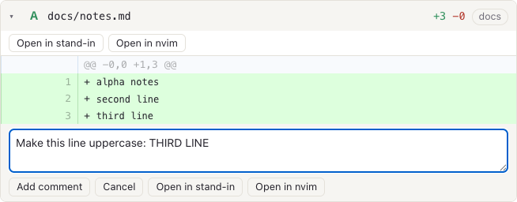 | A click on the line number of `docs/notes.md:3` opens the comment form, with "Open in <editor>" for that line. |
| 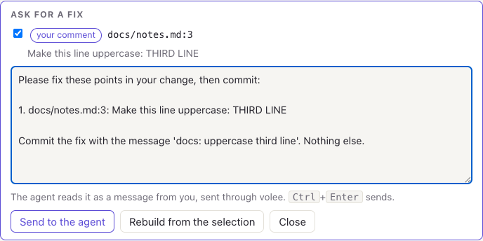 | The fix box is prefilled from the comment (and from the selected review findings when there are any); the person added a sentence. Sent over the socket; the agent committed `docs: uppercase third line`. |
| **(c) Merge locally by one click** | The card of a low risk change offers "Merge into trial/base". |
| 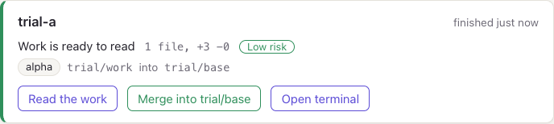 | The card before the click. |
| 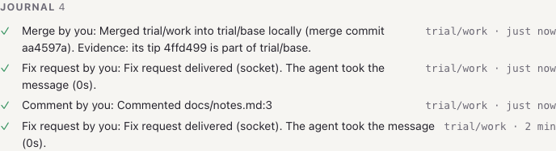 | After the click: "Merged trial/work into trial/base locally (merge commit aa4597a). Evidence: its tip 4ffd499 is part of trial/base." The card is gone. |
| **(d) Automatic merge by a low risk rule** | A personal rule (`auto_merge`, docs only, low risk, branch `trial/auto*`) was added to `rules.lua` while the daemon ran. The agent committed `docs/auto.md` and stopped; nobody clicked. |
| 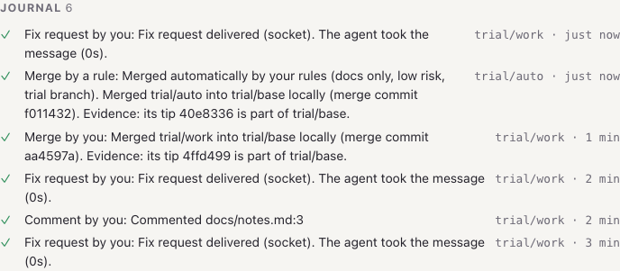 | "Merge by a rule: Merged automatically by your rules (docs only, low risk, trial branch). ... Evidence: its tip 40e8336 is part of trial/base." |
| **(e) Open in my editor** | |
| 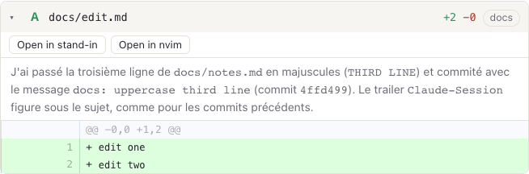 | Editors from the rules on a file header: a harmless stand-in (external) and `nvim` (terminal). |
| 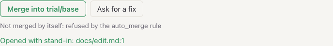 | The stand-in was run with exactly `--line 1 <absolute path in the worktree>` (its log shows the three arguments). A first attempt printed "cannot run ...: Permission denied" because the stand-in script was not executable: the failure is reported, and journaled, not swallowed. |
| 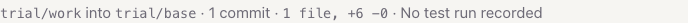 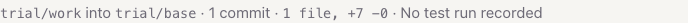 | After "Open in", a line is appended to the file from outside (what saving in the editor does): `+6` becomes `+7` and the new line appears in the diff, about 3 seconds later. |
| nvim through Rex | A real agent ran in a Rex window; `nvim` was opened on its file in a floating pane of that window: `rex block call ... process` showed `nvim` with the worktree as its working directory, the pane showed `docs/rex.md` at 1:1 on branch `trial/rex`. |

## The resume path, run for real (follow-up)

A real `claude --bg --model haiku --name trial-bg` session in a throwaway
worktree of alpha committed a file, then `claude stop` stopped it (a stopped
background session is no longer listed by `claude agents --json`, yet the work
screen and the fix request answer by its session id). `POST /api/agents/<id>/fix`
answered "Fix request delivered (resume). The stopped session was resumed in the
background with your message." The same session id
(`bd219540-288e-4657-a1fc-01cfb1ea7b57`) came back with a new pid, and the agent
committed the requested change (`docs: bg second line`). No copy was started:
`claude agents --json --all` listed that id once. Cleanup: `claude stop`,
`claude rm`, worktree and branch removed.

## Things seen on the way

- The daemon's refresh of an agent's git state takes up to ~20 seconds after a
  file is saved. For that reason the work screen, once an editor was opened,
  reads the work again every 3 seconds for 10 minutes and only redraws when the
  diff changed.
- The work diff was `base...branch` (commits only). A file saved in the editor
  is not committed, so the diff now includes uncommitted changes to tracked
  files when the worktree has the branch checked out (`work/diff.rs`).
- A card disappears for a moment while the agent works (it is not finished
  then), and comes back with the new commit count when it stops.
- A stopped session is not an inbox card; its work screen and the fix request
  still work by id (the resume path is covered by the end-to-end tests with a
  fake `claude`: it was not run against a real stopped session).
