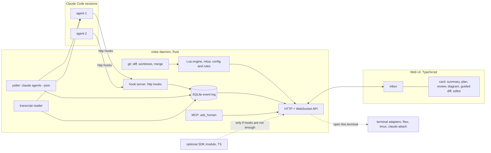

# volee v2: framing note

Status: draft for Jeff, 2026-11-21. Branch `v2`. Nothing in this note is
applied yet: no code, doc or ADR of 0.18 is moved or deleted.

## 1. Why v2

volee 0.18 is judged badly designed, for three reasons:

- **It owns terminals instead of observing.** One `volee-host` process per
  agent, a terminal emulator (libghostty-vt), take-over, edit mode, a typist
  that types messages at a prompt. Most of the 0.18 defects come from there
  (see section 8).
- **It redoes what Claude Code now provides**: background sessions,
  `claude agents`, messaging between sessions, agent teams.
- **It puts in a TUI what needs a graphical interface**: reading a diff, a
  schema of a change or a plan is not a terminal job. The TUI is 56 000 lines
  and the largest crate by far.

Decision of 2026-11-21: restart from scratch as a new major version, built
after and with rex-cockpit (the lab).

## 2. Goals and non-goals (v1 scope)

**Goal.** A control tower against AI fatigue. volee observes Claude Code,
tells the person what needs a decision, and lets them decide with as little
reading as the risk allows.

**v1 = the decision inbox.** Three kinds of cards: finished work, question,
permission. Everything else is out.

**Out of v1:** agent graph, messages between agents, multi-repo missions,
mobile, any terminal ownership. Terminal adapters (Rex, tmux,
`claude attach`) are optional and only serve "open this agent's terminal".
volee is not a multiplexer.

**Principle: each technology is picked on its merits for the need**, never
for consistency with rex-cockpit or with itself. The lab proves ideas, not
stacks (it is Bun and TypeScript; v2 is not bound to it).

## 3. Users and the AI fatigue problem

The user runs several Claude Code agents at once, across repos. The scarce
resource is no longer typing, it is attention: every agent produces work to
read, questions to answer and permissions to grant, at unpredictable moments,
with no sense of what matters. The failure modes are rubber-stamping (approve
everything) and context-switch overload (read everything).

Principles that follow:

- **Validate according to risk**, configurable per repo and per developer: a
  typo fix in docs is merged on a glance, a migration needs the full screen.
- **Small changes in layers**: one-line summary, then plan, then schema, then
  diff, each opened only if needed.
- **Show what the AI did and why**: plan followed, decisions taken, what was
  not done.
- **The AI review is an opinion, never a gate on its own.**

## 4. What Claude Code gives us (observe, do not own)

Claude Code 2.1.330 already provides:

| Need | Source |
| --- | --- |
| Which agents exist and their state | `claude agents --json [--all]` (id, sessionId, name, cwd, kind, startedAt, state, status, waitingFor, pid) |
| Events as they happen | hooks: Notification (`permission_prompt`, `idle_prompt`, `agent_needs_input`, `agent_completed`), Stop, SubagentStart/Stop, TaskCreated/Completed, PermissionRequest |
| Push to a local server | `http` hooks: JSON posted, decision read from the response |
| What the agent did | transcripts `~/.claude/projects/<encoded dir>/<session>.jsonl` |
| Answer permissions and questions programmatically | Agent SDK (TS, Python) `canUseTool` |
| Pre-review | native `/code-review` (Haiku by default, two reviewers when risky) |

Not provided: any public API to type into a session open in a terminal. v2
never types into a terminal. Where a decision must come back to an interactive
session, it goes through a hook response (T1, T2) or an SDK session (T3).

AGENTS.md and ADR 0004 forbid parsing Claude Code internal files. Transcripts
are the one exception to decide (question 2): they are the only source of
"what the AI did and why". Proposal: one tolerant module, degrading to
hooks-only when parsing fails.

Pre-review: Open Code Review in delegation mode was tested on PR #185, no net
gain at equal model. Decision: native `/code-review`.

## 5. Architecture draft

- **Daemon (Rust, majority of the code).** Receives Claude Code `http` hooks,
  polls `claude agents --json`, reads transcripts, runs git (diffs, worktrees,
  merge), keeps the database, serves `ask_human` over MCP, serves the UI API
  (HTTP + WebSocket) on localhost.
- **Lua for configuration and rules (decided by Jeff, like Rex).** The daemon
  embeds Lua through the `mlua` crate. One Lua config file (repos, defaults,
  adapters). The risk-based validation and merge rules, per repo and per
  developer, are Lua functions: they receive a change (paths, size, tests,
  review findings, agent, repo) and return a risk level, the layers to show
  and what a merge requires. Rust owns the facts and the effects (git, merge,
  database); Lua only decides. To settle at design time: sandbox the Lua state
  (no `os`, `io`, no network, instruction and time limits), a stable versioned
  API, load errors shown in the UI and falling back to the safest rule
  (full read, no auto-merge), and a declarative default file so most people
  never write Lua.
- **UI (TypeScript web app served by the daemon).** A browser runs only
  JavaScript, so TypeScript here is forced by the platform, not by habit.
  Monaco or CodeMirror (diff and in-place fix), diff2html (guided diff),
  Mermaid (diagram of the change), React Flow (later, agent graph, not v1).
  Tauri may wrap it later as a desktop app: the UI must not depend on it.
- **SDK module (TypeScript, optional).** The Agent SDK exists only in
  TypeScript and Python: no SDK in Lua or Rust. Only if checks show hooks are
  not enough AND the SDK is usable under the terms (see T3). Never
  reimplement the SDK internal protocol in Rust.
- **Adapters (optional).** "Open this agent's terminal": Rex, tmux,
  `claude attach`. They locate and focus; they never read or type.

Security: the local server binds to 127.0.0.1, hook and UI calls carry a
per-install token, no secret in the database or in the Lua file.

## 6. The decision inbox

**Cards**

| Kind | Trigger | Decision |
| --- | --- | --- |
| Finished work | `agent_completed` / Stop, worktree with commits | merge, fix, comment |
| Question | `agent_needs_input`, AskUserQuestion | answer (proposed answers first) |
| Permission | `permission_prompt`, PermissionRequest | allow once, allow rule, deny |

**Card screen** (finished work): summary (what and why), plan followed (from
transcript), AI review opinion (`/code-review`, opinion only), Mermaid diagram
of the change, guided diff (ordered by meaning, not by file name, with the
review notes inline).

**Actions:** merge according to the rules, ask for a fix (sent back to the
agent), comment a line (becomes the fix request), fix in the embedded editor.

**Risk-based validation.** Each change gets a risk level from the Lua rules
(paths touched, size, migrations, dependencies, tests changed or not, review
findings). The level picks the layers shown and whether a merge needs a full
read, a glance, or can be automatic. A per-repo rules file and a per-developer
override, so the same change can need different care for two people.

**Validated in the lab (rex-cockpit, `src/inbox*.ts`, `PLAN.md`), to reuse:**
agents joined by pid between `claude agents --json` and the terminal; groups
"waiting for an answer", "to review", "to tidy"; per-worker diff summary
(ahead, dirty, merged) with squash and cherry-pick recognition; the base of a
worker is its checkout branch or its remote, whichever is furthest ahead;
"tidy" only when the branch holds nothing unique; `/code-review` run in Haiku
from the card. What the lab could not do and v2 must: decide a permission or a
question without typing into the terminal.

## 7. Pending checks

**T1 and T3 are answered; T2 is still running.**

**T1. PermissionRequest `http` hook.** Does it wait for the local server
answer, what is the maximum delay, are allow and deny applied?
- Result (2026-11-21, Claude Code 2.1.330): **yes, it waits.** An 8 s delay
  was measured, then the tool ran. `allow` and `deny` (`decision.behavior` plus
  a message shown to the model) are applied.
- The normal "Do you want to proceed?" dialog is shown immediately in the
  terminal during the wait: the hook is a concurrent decider. If the human
  answers in the terminal first, the tool runs and the server gets no signal,
  so an inbox decision may arrive stale.
- On timeout (configurable `timeout`, 5 s tested) it falls back to the normal
  dialog, not to a deny; a late allow is ignored. Timeout changes are picked up
  without restart. Assumed from the docs, not measured: default http timeout
  600 s, `"onFailure": "block"` to fail closed.
- Payload: `session_id`, `transcript_path`, `cwd`, `permission_mode`,
  `hook_event_name`, `tool_name`, `tool_input`, `permission_suggestions`. No
  `tool_use_id` and no request id.
- Design consequences: permission cards are handled by the daemon, no SDK for
  them. Set an explicit long timeout. Treat inbox answers as possibly stale and
  reconcile with the transcript (a card disappears when the tool ran). Correlate
  requests without an id by `session_id` plus `tool_input`. Falling back to the
  terminal dialog is the safe default when nobody answers.

**T2. PreToolUse hook on AskUserQuestion answering in place of the user, in an
interactive session.**
- Result: _pending_.
- If yes: question cards are answered from the inbox for any session.
- If no: questions are observed only (card + "open terminal"); answering needs
  sessions started through the SDK, or `ask_human` over MCP.

**T3. Agent SDK with the subscription.** Result (2026-11-21):
- It works with the subscription login, without API key, and `canUseTool`
  answers both permissions and AskUserQuestion.
- SDK sessions do **not** appear in `claude agents --json`: only their
  transcript exists. volee would have to track them itself and could not see
  them with the poller.
- Anthropic forbids third-party products from offering claude.ai login.
  Individual local use is allowed; an open source tool that each user runs
  themselves is a grey zone. volee is public and open source, so the SDK
  module must not offer or handle login: it would only use the login the user
  already has, and we should get the exact terms confirmed before shipping it.
- Consequence: the SDK is a fallback, not a foundation. Decision rule: if T1
  and T2 pass, no SDK module in v1. If one fails, the SDK module is opt-in,
  off by default, for sessions volee itself starts, with the licensing risk
  documented. Otherwise accept observation-only for what hooks cannot answer.

Best case (T1 passed, T2 to pass): no SDK, no terminal typing, Rust daemon
plus web UI only.

## 8. Keep, adapt, drop (from 0.18)

Sizes are lines of Rust in `crates/` at `origin/main`.

| Part | Lines | Verdict | Why |
| --- | --- | --- | --- |
| `volee-store` (SQLite event log, hook spool) | 1.5k | **Keep** | Matches ADR 0003, small, tested |
| `volee-mcp` (rmcp) | 2.2k | **Keep, adapt** | `ask_human` stays; drop agent-to-agent tools |
| `volee-config` (TOML) | 2k | **Replace** | Becomes the Lua config (mlua); the repo model carries over |
| `volee-git` | 8.5k | **Keep, trim** | Diffs, worktrees, delivery evidence (ADR 0011) are core |
| `volee-core` | 14k | **Adapt** | Events, agent identity, merge rules; drop host and screen concepts |
| `volee-proto` | 4.5k | **Adapt** | JSON-RPC over a socket becomes HTTP + WebSocket |
| `volee-daemon` | 23k | **Adapt, mostly rewrite** | Keep event log wiring, merge flow, ask flow; drop `typist.rs`, `views.rs`, `screens.rs`, `panes.rs`, `resume.rs`, launch |
| `volee-harness` | 10k | **Adapt** | Claude Code profile and hook settings stay; launch, preview, take over go |
| `volee-cli` | 7.4k | **Adapt** | Becomes thin: start the daemon, open the UI |
| `volee-mux` | 3.7k | **Adapt** | Becomes the optional "open this terminal" adapters |
| `volee-host`, `volee-term`, `volee-tui` | 65k | **Drop** | The terminal-owning design and the TUI |

Known 0.18 defects, all in what is dropped (`crates/volee-daemon/src/typist.rs`):
edit-mode take-over (an `owned` check, then a Control connection that always
takes the input), pasting into a draft or a dialog box, double sends. They are
a consequence of typing into terminals, not bugs to fix in v2.

**ADRs.** Keep as history, mark superseded: 0002, 0009, 0019 to 0028, 0034,
0035 (terminal ownership, TUI, host, emulator, edit mode). Keep: 0001, 0003,
0004, 0010, 0011, 0012, 0013. Adapt: 0005, 0006 (messaging reduced to
`ask_human`), 0007 and 0032 (merge rules survive, missions leave v1), 0008
(multiplexers optional becomes the founding principle), 0014, 0015. Drop or
archive: 0029 to 0031, 0033. New ADRs: Lua config and rules, observe-only,
web UI, SDK policy.

**Docs.** The mdBook site stays, rebuilt around the inbox; the architecture
overview is rewritten first.

**Journeys.** The idea stays: a release gate that does a person's trip for
real. The scripts are tied to the TUI and tuios, so they are rewritten as
browser journeys (real Claude Code through hooks, real UI driven by
Playwright). Keep `journey.py` structure and the sandbox convention.

**Release.** Keep dist, git-cliff, `RELEASING.md`, CI and cargo-deny. Add a UI
build step (the web bundle is embedded in the binary).

## 9. Open questions for Jeff

1. **Name and repo.** Keep `volee` and `volee-org/volee` for v2, or a new name
   to mark the break? (Recommendation: keep.)
2. **Transcripts.** OK to read them despite ADR 0004, behind one tolerant
   module, hooks-only as fallback?
3. **Merge authority.** v1 merges according to the Lua rules, including
   automatically at low risk. Acceptable, or always one click?
4. **Lua surface.** Start with a declarative default plus Lua escape hatch, or
   Lua only? Who may write rules per developer (a user file outside the repo)?
5. **SDK and terms.** Given T3 (grey zone for an open source tool), do we ship
   an opt-in SDK module at all, or wait for T1 and T2 and decide then?
6. **UI shell and editor.** Plain browser tab first, Tauri later: confirm.
   Monaco (heavier, VS Code feel) or CodeMirror (lighter)?
7. **Review model.** Haiku by default, two reviewers when risky: who decides
   "risky", the Lua rules or the person per card?
8. **First targets** for rules (slapeo, volee itself), and whether a Rex
   adapter alone is enough for v1.
9. **License and public status** unchanged (MIT OR Apache-2.0, public)?

## 10. Proposed way to restart from scratch on branch `v2`

Options:

- **A. One commit that removes the old code, history kept.** `v2` branches
  from `main`, a `legacy/0.x` pointer marks 0.18, keepers stay in place and are
  adapted commit by commit. History, blame and the release pipeline survive.
- **B. Orphan branch.** Clean tree, no history. Clearer break, but loses blame
  for the code we keep (store, git, mcp) and the CI and release setup must be
  rebuilt or copied by hand.
- **C. New repository.** Same loss as B, plus issues, stars and the docs site
  URL.

**Recommendation: A**, in a few reviewable commits: (1) remove the
terminal-owning crates and the TUI (host, term, tui, TUI journeys), with the
superseded ADRs kept and marked, not deleted; (2) cut the daemon down to the
event log, git, merge flow and MCP; (3) the new skeleton (hook server,
`claude agents --json` poller, Lua engine). Before commit 1, a maintainer
creates `legacy/0.x` on the current `main` head so 0.18 stays maintainable.
`main` keeps shipping 0.18 until v2 reaches the inbox, then v2 is merged and
released as `v2.0.0`. This note applies none of it.
