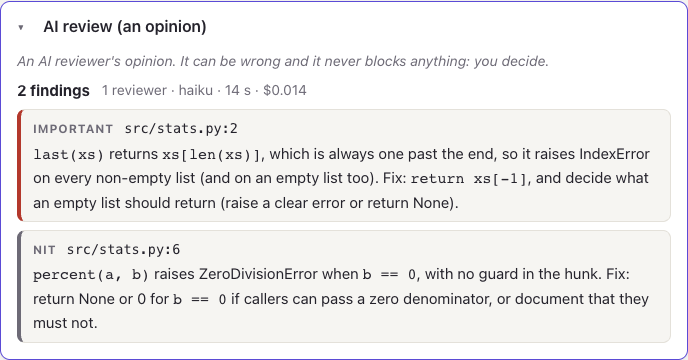
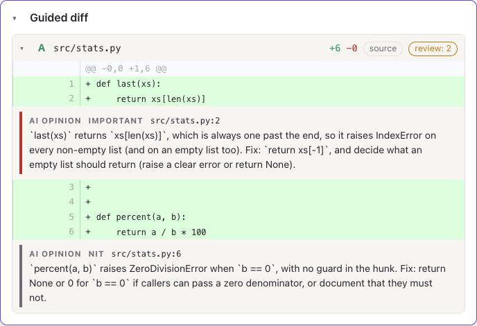

# Pre-review: measurements (2026-11-22)

Claude Code 2.1.330, model `haiku` (claude-haiku-5-5), a branch of two small
functions with a deliberate bug each (`xs[len(xs)]`, a division without a
guard). Decision: [ADR 0039](../src/adr/0039-the-pre-review-is-claude-codes-code-review-and-an-opinion.md).

| Run | Time | Cost | Output |
| --- | --- | --- | --- |
| `-p "/code-review low main...feat/stats"` | 8 s | 0.0146 USD | 2 findings, `file:line - severity - summary. Fix: ...` |
| same, `--output-format json --json-schema ...` | 8 s | 0.0151 USD | same text; the schema is ignored, no typed result |
| `-p "/code-review medium main...feat/stats"` | 24 s | 0.0155 USD | 2 findings, numbered, with `Failure scenario:` lines |
| in the daemon, real agent in `cockpit-sandbox/alpha`, `low` | 13 s | 0.0156 USD | 2 findings stored, one `nit`, one `important` |

What the docs and the runs say:

- `/code-review` runs in the foreground in `-p`; levels `low|medium|high|xhigh|max`
  (`ultra` is cloud: not used). The target comes after the level: `main...tip`.
- Findings are text. `ReportFindings` is for host applications, not `-p`.
  `--json-schema` is not applied to a slash command.
- The layout and the language follow the level and the user's `language`
  setting, hence a tolerant parser and the raw text kept.
- Line numbers are the model's: `low` gave 10 and 14 for lines 8 and 12, then 6
  and 10 on the next run. They are shown as said, not checked.
- `-p` runs hooks (user and project). `--settings '{"disableAllHooks":true}'`
  gave 0 hook events; `--bare` needs an API key.
- Read-only: `--permission-mode plan` with `--disallowedTools
  Edit,Write,NotebookEdit`; never `--fix`.

## The interface

Real trial (isolated daemon, `[review] auto = false`, a haiku agent in
`cockpit-sandbox/alpha` on a throwaway branch with two deliberate bugs, headless
Chrome driven by Playwright): the card showed no badge; on the work screen the
review layer offered "Run review"; the click showed the running state, then the
two findings, pushed over the events stream with no reload; the guided diff
showed both under their lines; the card ended with "Review: 2 findings".

| | |
| --- | --- |
| Running |  |
| Done |  |
| Inline in the guided diff |  |
| Badge on the card |  |
