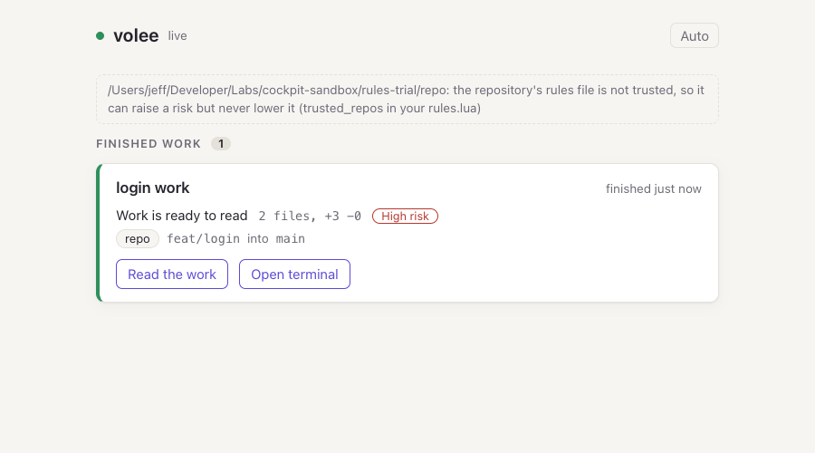
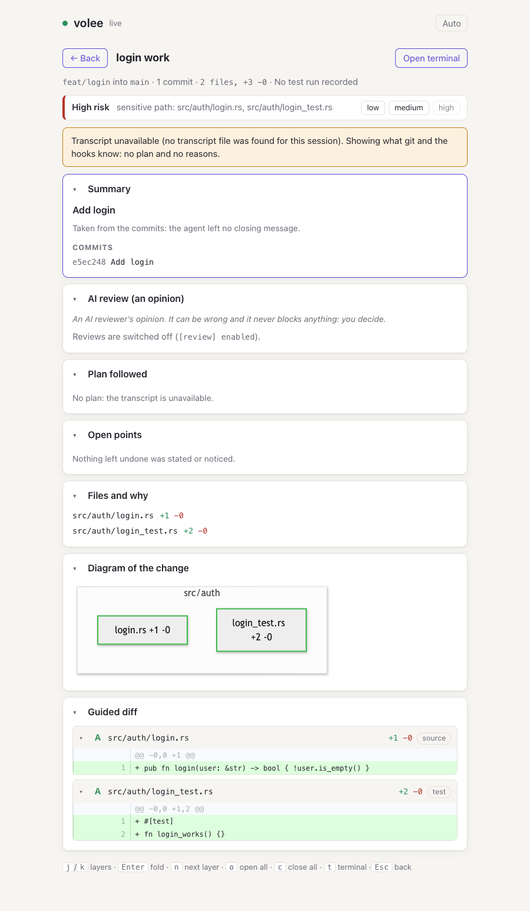
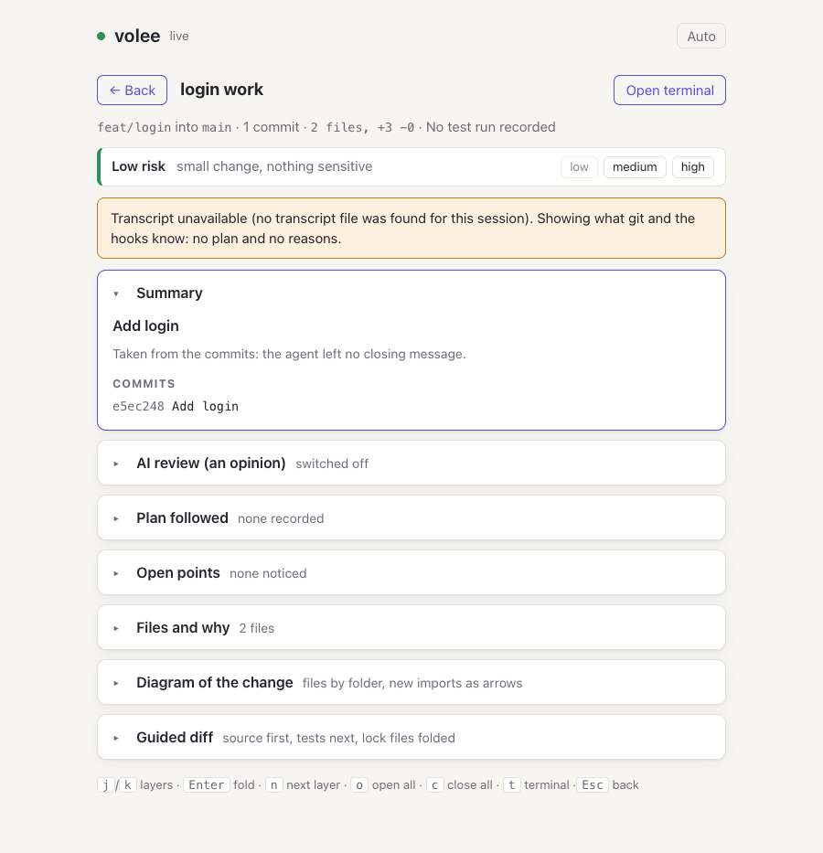

# Step 8 trial: the rules in a real daemon

Run on 2026-11-22 with an isolated daemon (own state, config and socket
directories, own hook port), a real git repository and worktree with a commit
that touches `src/auth/`, a repository rules file and a personal one, real
hook events posted to the real hook server, the real bundled interface, and
headless Chrome through Playwright.

What was **not** done as the plan said: the session was not a real
interactive `claude --model haiku`. Claude Code's trust prompt for a new folder
writes to `~/.claude.json`, which this step was told never to touch, so the
prompt was declined and `claude agents --json` was answered by a stand-in
script. Everything after the listing (hooks, git, rules, API, interface) was
real. The Rust end-to-end tests (`crates/volee-daemon/tests/rules_web.rs`)
cover the same paths without the stand-in.

| Step | What it shows |
| --- | --- |
| Repository rules: `sensitive_paths = { "src/auth/**" }`; personal rules: `layers.low = { "summary" }` | |
|  | The finished card is **High risk**; the notice says the repository's file is not trusted, so it can raise a risk but never lower it. |
|  | The work screen: the reason (the two sensitive paths) and **every layer open**. |
| The repository file is edited while the daemon runs: `sensitive_paths = { "src/billing/**" }` | |
|  | The same change is now **Low risk**, with no restart. |
|  | Only the summary is open, as the personal file's `layers.low` says. |
| The file is broken (`risk = ,` on line 3) | |
|  | A banner with file and line; the card falls back to High risk. `volee doctor` prints the same line (`rules error: .../rules.lua:3: unexpected symbol near ','`). |
| The person raises the risk by hand | |
|  | **High risk (set by you)**, "Back to the rules (low)", every layer open. The choice is kept for this tip only. |
