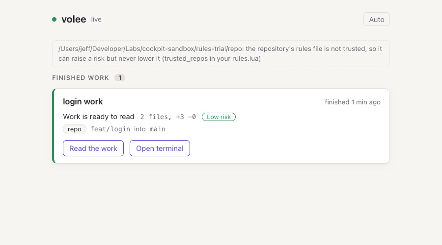
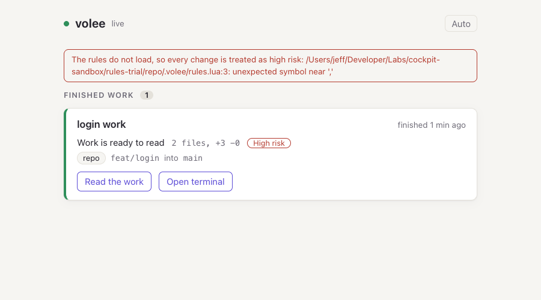
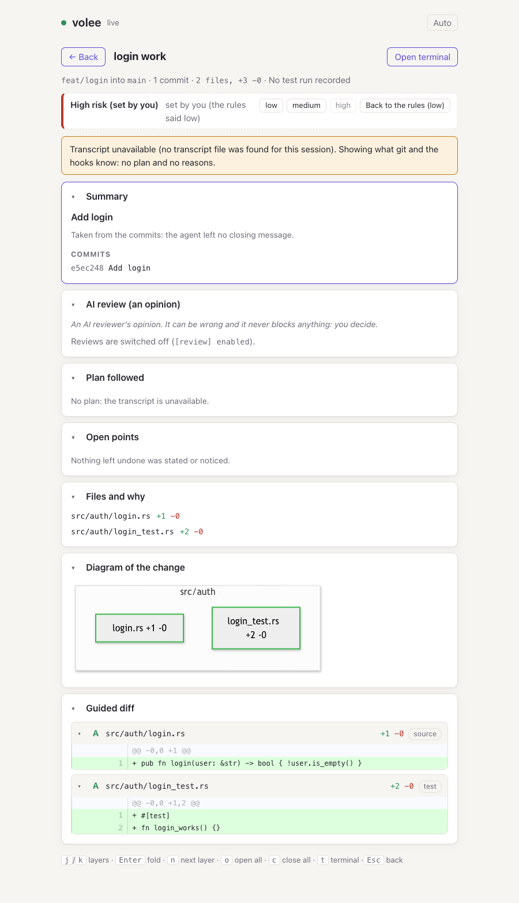
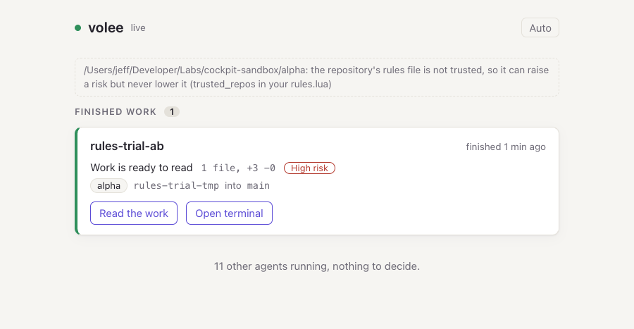
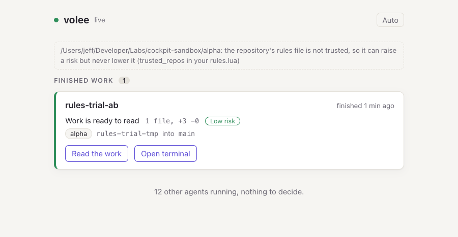

# Step 8 trial: the rules in a real daemon

Run on 2026-11-22 with an isolated daemon (own state, config and socket
directories, own hook port), a real git repository and worktree with a commit
that touches `src/auth/`, a repository rules file and a personal one, real
hook events posted to the real hook server, the real bundled interface, and
headless Chrome through Playwright.

The screenshots 1 to 6 below use a stand-in for `claude agents --json`
(Claude Code's trust prompt for a new folder writes to `~/.claude.json`, which
this step never touches). They were then **redone with a real session**: a
throwaway worktree of the already trusted sandbox repository, a real
interactive `claude --model haiku` in tmux, the real `claude agents --json`,
and a real commit of `src/auth/login.rs` made by the agent. The card showed
high risk with every layer; after editing the repository rules file while
the daemon ran, the same card showed low risk with the summary only (7 and 8).
The Rust end-to-end tests (`crates/volee-daemon/tests/rules_web.rs`) cover the
same paths too.

| Step | What it shows |
| --- | --- |
| Repository rules: `sensitive_paths = { "src/auth/**" }`; personal rules: `layers.low = { "summary" }` | |
|  | The finished card is **High risk**; the notice says the repository's file is not trusted, so it can raise a risk but never lower it. |
|  | The work screen: the reason (the two sensitive paths) and **every layer open**. |
| The repository file is edited while the daemon runs: `sensitive_paths = { "src/billing/**" }` | |
|  | The same change is now **Low risk**, with no restart. |
|  | Only the summary is open, as the personal file's `layers.low` says. |
| The file is broken (`risk = ,` on line 3) | |
|  | A banner with file and line; the card falls back to High risk. `volee doctor` prints the same line (`rules error: .../rules.lua:3: unexpected symbol near ','`). |
| The person raises the risk by hand | |
|  | **High risk (set by you)**, "Back to the rules (low)", every layer open. The choice is kept for this tip only. |
| Real session (haiku, real `claude agents`), sensitive path | |
|  | **High risk** on the finished card of the real session. |
| The repository rules file is edited while the daemon runs | |
|  | The same card, **Low risk**. |
